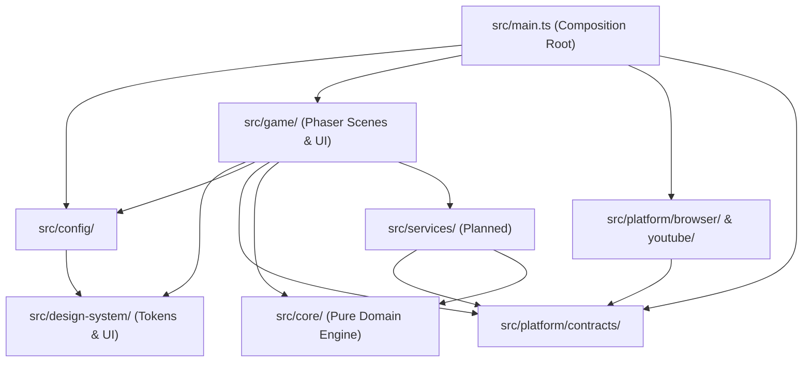

# Architecture — Bottle Shuffle

This document defines the module structure, responsibilities, dependency boundaries, and platform architecture for **Bottle Shuffle**.

## 1. Architectural Principles

- **Client-only execution:** All game logic, rendering, and bundled assets run locally in the browser or YouTube Playables WebView with zero runtime network dependencies.
- **Pure core domain:** Puzzle rules, state transitions, match evaluation, scoring, and level definitions live in pure TypeScript with zero imports from Phaser, DOM/Browser APIs, or the YouTube Playables SDK.
- **Explicit platform boundary:** Host-environment responsibilities (lifecycle signals, persistence, audio state, pause/resume) are isolated behind `GamePlatform`.
- **Composition over inheritance:** Scenes compose helper modules, services, and design-system components rather than building deep class hierarchies.
- **Pragmatic minimalism:** Only create modules when the active task requires them; avoid speculative abstractions and empty boilerplate classes.

## 2. Dependency Boundaries



### Enforced Rules

| Layer                               | May Depend On                                                                                          | Must NOT Depend On                                                                      |
| ----------------------------------- | ------------------------------------------------------------------------------------------------------ | --------------------------------------------------------------------------------------- |
| `src/core/`                         | Pure TypeScript only (zero external runtime deps)                                                      | `phaser`, DOM/Browser globals, `src/game/`, `src/platform/`, `src/design-system/`       |
| `src/platform/contracts/`           | TypeScript types only                                                                                  | `phaser`, browser globals, concrete adapters                                            |
| `src/platform/browser/`             | `src/platform/contracts/`, browser APIs                                                                | `phaser`, `src/game/`, `src/core/`                                                      |
| `src/platform/youtube/` _(planned)_ | `src/platform/contracts/`, `ytgame` SDK                                                                | `phaser`, `src/game/`, `src/core/`                                                      |
| `src/design-system/`                | Tokens, type-only `BottleId` from `src/core/models/BottleId`, Phaser (for UI primitives only)          | `src/core/` engine logic, `src/platform/`                                               |
| `src/config/`                       | `src/design-system/tokens/`, `phaser` (`gameConfig.ts` only)                                           | `src/platform/` concrete implementations                                                |
| `src/game/`                         | `phaser`, `src/core/`, `src/design-system/`, `src/config/`, `src/services/`, `src/platform/contracts/` | Concrete platform implementations (`BrowserGamePlatform`, future `YouTubeGamePlatform`) |
| `src/main.ts`                       | Composition root — wires platform, config, services, and Phaser scenes                                 | Game rules implementation                                                               |

## 3. Directory Structure (Current & Planned)

Directories marked **(Active)** exist as of Task 01. Directories marked **(Planned)** will be introduced incrementally in future tasks.

```text
bottle-shuffle/
├── public/
│   └── assets/                  # (Planned) Locally bundled game assets
│       ├── bottles/             # (Planned) Bottle sprites / artwork
│       ├── backgrounds/         # (Planned) Scene backgrounds
│       ├── icons/               # (Planned) UI icons
│       ├── audio/               # (Planned) SFX and music
│       ├── fonts/               # (Planned) Local font files
│       └── effects/             # (Planned) Particle / celebration effects
├── src/
│   ├── core/                    # (Planned) Pure, engine-agnostic puzzle domain
│   │   ├── models/              # (Planned) Bottle, Board, Level, GameState types
│   │   ├── engine/              # (Planned) Shuffle, swap, match counting, win detection
│   │   ├── scoring/             # (Planned) Move/score/star calculation
│   │   └── levels/              # (Planned) Level progression definitions
│   ├── game/                    # (Active) Phaser 3 presentation layer
│   │   ├── scenes/              # (Active) BootScene, HomeScene (temporary)
│   │   ├── components/          # (Planned) Bottle views, board layout, HUD
│   │   ├── animations/          # (Planned) Swap, feedback, and victory tweens
│   │   └── input/               # (Planned) Pointer/tap/drag interaction handlers
│   ├── design-system/           # (Active) Shared visual tokens & UI primitives
│   │   ├── tokens/              # (Active) colors.ts, typography.ts
│   │   ├── components/          # (Planned) Reusable Phaser UI buttons, panels, badges
│   │   └── theme/               # (Planned) Theme presets & semantic mappings
│   ├── platform/                # (Active) Host platform abstraction
│   │   ├── contracts/           # (Active) GamePlatform interface & callback types
│   │   ├── browser/             # (Active) BrowserGamePlatform (localStorage + visibility)
│   │   ├── youtube/             # (Planned) YouTube Playables SDK adapter
│   │   └── createPlatform.ts    # (Active) Runtime platform factory
│   ├── services/                # (Planned) Persistence, audio, settings orchestration
│   ├── config/                  # (Active) appConfig.ts (pure) & gameConfig.ts (Phaser)
│   ├── utils/                   # (Planned) Shared pure helpers (e.g. deterministic RNG)
│   ├── types/                   # (Planned) Shared cross-cutting TypeScript types
│   └── main.ts                  # (Active) Application bootstrap & lifecycle binding
├── tests/
│   ├── unit/                    # (Active) Fast, Phaser-free Vitest unit tests
│   └── integration/             # (Planned) Cross-module & scene integration tests
├── docs/
│   ├── ARCHITECTURE.md          # (Active) Module responsibilities & boundaries
│   └── PROGRESS.md              # (Active) Task tracking and roadmap
├── index.html                   # (Active) Entry HTML with future YT SDK hook point
├── package.json                 # (Active) Dependencies & scripts
├── tsconfig.json                # (Active) Strict TypeScript configuration
├── vite.config.ts               # (Active) Relative-path local bundle build config
├── vitest.config.ts             # (Active) Vitest configuration
├── eslint.config.js             # (Active) Strict TypeScript ESLint flat config
├── .prettierrc                  # (Active) Prettier formatting rules
├── AGENTS.md                    # (Active) Persistent AI coding agent guidelines
└── README.md                    # (Active) Project overview and developer guide
```

## 4. Platform Abstraction & YouTube Playables Alignment

The `GamePlatform` contract (`src/platform/contracts/GamePlatform.ts`) models the verified lifecycle and host capabilities required by YouTube Playables while staying completely decoupled from the `ytgame` SDK:

- **`initialize()`**: Prepares platform listeners before Phaser boots.
- **`notifyFirstFrameReady()`**: Invoked by `BootScene` once the first frame is ready (maps to `ytgame.game.firstFrameReady()` in future YouTube integration).
- **`notifyGameReady()`**: Invoked by `HomeScene` once the interactive entry screen has rendered (maps to `ytgame.game.gameReady()`).
- **`loadData()` / `saveData(data)`**: String-based persistence contract (maps to `localStorage` locally and `ytgame.game.loadData()` / `saveData()` on YouTube Playables).
- **`isAudioEnabled()` / `onAudioEnabledChange()`**: Propagates host mute state to Phaser's sound manager.
- **`onPause()` / `onResume()`**: Pauses and resumes the Phaser game loop and audio when the host pauses the game or the browser tab becomes hidden.

`src/main.ts` wires `GamePlatform` into Phaser lifecycle events and injects it into scenes via constructor injection. Adding YouTube Playables support later only requires implementing `src/platform/youtube/YouTubeGamePlatform.ts`, updating `createPlatform()`, and including the official SDK script tag in `index.html`.

## 5. Responsive Viewport & Scaling Strategy

- **Reference resolution:** `1280 × 720` (16:9 landscape-first).
- **Phaser scale mode:** `Phaser.Scale.RESIZE` with `Phaser.Scale.CENTER_BOTH`.
- **No forced orientation:** Landscape and portrait orientations are both first-class. `computeViewportMetrics(width, height)` in `src/config/appConfig.ts` derives `'landscape' | 'portrait'` and a clamped layout scale relative to `1280 × 720` (landscape) or `720 × 1280` (portrait), safely clamping zero-size initial viewports (such as Android WebView cold starts).
- **Scene layout contract:** Scenes listen to `Phaser.Scale.Events.RESIZE`, recompute positions/scales via `computeViewportMetrics`, and detach their resize listener on `Phaser.Scenes.Events.SHUTDOWN`.
