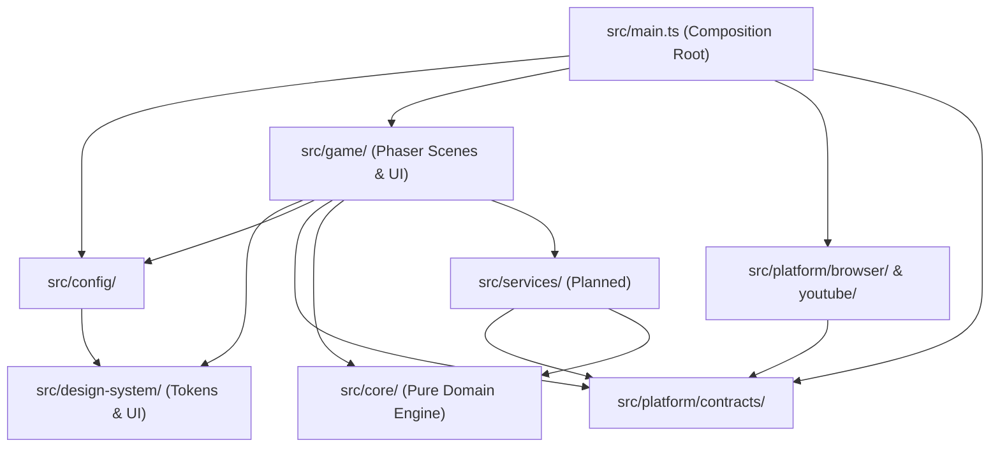

# Architecture — Bottle Shuffle

This document defines the module structure, responsibilities, dependency boundaries, and platform architecture for **Bottle Shuffle**.

## 1. Architectural Principles

- **Client-only execution:** All game logic, rendering, and bundled assets run locally in the browser or YouTube Playables WebView with zero runtime network dependencies.
- **Pure core domain:** Puzzle rules, state transitions, match evaluation, scoring, and level definitions live in pure TypeScript with zero imports from Phaser, DOM/Browser APIs, or the YouTube Playables SDK.
- **Explicit platform boundary:** Host-environment responsibilities (lifecycle signals, persistence, audio state, pause/resume) are isolated behind `GamePlatform`.
- **Composition over inheritance:** Scenes compose helper modules, services, and design-system components rather than building deep class hierarchies.
- **Pragmatic minimalism:** Only create modules when the active task requires them; avoid speculative abstractions and empty boilerplate classes.

## 2. Dependency Boundaries



### Enforced Rules

| Layer                               | May Depend On                                                                                          | Must NOT Depend On                                                                      |
| ----------------------------------- | ------------------------------------------------------------------------------------------------------ | --------------------------------------------------------------------------------------- |
| `src/core/`                         | Pure TypeScript only (zero external runtime deps)                                                      | `phaser`, DOM/Browser globals, `src/game/`, `src/platform/`, `src/design-system/`       |
| `src/platform/contracts/`           | TypeScript types only                                                                                  | `phaser`, browser globals, concrete adapters                                            |
| `src/platform/browser/`             | `src/platform/contracts/`, browser APIs                                                                | `phaser`, `src/game/`, `src/core/`                                                      |
| `src/platform/youtube/` _(planned)_ | `src/platform/contracts/`, `ytgame` SDK                                                                | `phaser`, `src/game/`, `src/core/`                                                      |
| `src/design-system/`                | Tokens, type-only `BottleId` from `src/core/models/BottleId`, Phaser (for UI primitives only)          | `src/core/` engine logic, `src/platform/`                                               |
| `src/config/`                       | `src/design-system/tokens/`, `phaser` (`gameConfig.ts` only)                                           | `src/platform/` concrete implementations                                                |
| `src/game/`                         | `phaser`, `src/core/`, `src/design-system/`, `src/config/`, `src/services/`, `src/platform/contracts/` | Concrete platform implementations (`BrowserGamePlatform`, future `YouTubeGamePlatform`) |
| `src/main.ts`                       | Composition root — wires platform, config, services, and Phaser scenes                                 | Game rules implementation                                                               |

## 3. Directory Structure (Current & Planned)

Directories marked **(Active)** exist as of Task 01. Directories marked **(Planned)** will be introduced incrementally in future tasks.

```text
bottle-shuffle/
├── public/
│   └── assets/                  # (Planned) Locally bundled game assets
│       ├── bottles/             # (Planned) Bottle sprites / artwork
│       ├── backgrounds/         # (Planned) Scene backgrounds
│       ├── icons/               # (Planned) UI icons
│       ├── audio/               # (Planned) SFX and music
│       ├── fonts/               # (Planned) Local font files
│       └── effects/             # (Planned) Particle / celebration effects
├── src/
│   ├── core/                    # (Active) Pure, engine-agnostic puzzle & progression domain
│   │   ├── models/              # (Active) Bottle, Puzzle, GameState, Action & Event types
│   │   ├── engine/              # (Active) PuzzleGenerator, MatchCalculator, BottleSwapper, GameEngine
│   │   ├── levels/              # (Active) DifficultyConfig, LevelCatalog, ChapterDefinition, LevelValidator
│   │   ├── progression/         # (Active) ProgressionEngine, ProgressionState, CompletionRecord, Validator
│   │   ├── tutorial/            # (Active) TutorialEngine, TutorialPuzzleFactory, TutorialDefinition, state machine
│   │   ├── scoring/             # (Active) Deterministic move-efficiency scoring & three-star ratings
│   │   ├── settings/            # (Active) GameSettings, SettingsReducer, SettingsValidator
│   │   └── persistence/         # (Active) SaveData, SaveSchemaVersion, SaveDataFactory, SaveDataValidator, SaveError
│   ├── game/                    # (Active) Phaser 3 presentation layer
│   │   ├── scenes/              # (Active) BootScene, HomeScene, LevelSelectionScene, GameScene (campaign/practice/tutorial)
│   │   ├── components/          # (Active) Bottle views, board layout, HUD, Home, Level Selection, Tutorial UI, effects
│   │   ├── animations/          # (Active) Swap curves, coordinator, policy, victory, level & tutorial animations
│   │   ├── home/                # (Active) HomeController, HomeViewState, HomeViewStateMapper
│   │   ├── levels/              # (Active) LevelSelectionController, ViewState/Mapper, LevelUnlockTracker
│   │   ├── tutorial/            # (Active) TutorialController, TutorialViewState, TutorialViewStateMapper
│   │   ├── navigation/          # (Active) Typed SceneNavigator with transition locking & first-time tutorial routing
│   │   ├── gameplay/            # (Active) GameplayController, GameplayViewState, launch resolution
│   │   └── progression/         # (Active) ProgressionController (session-scoped campaign owner)
│   ├── design-system/           # (Active) Shared visual tokens & UI primitives
│   │   ├── tokens/              # (Active) colors.ts, typography.ts
│   │   ├── components/          # (Planned) Reusable Phaser UI buttons, panels, badges
│   │   └── theme/               # (Planned) Theme presets & semantic mappings
│   ├── platform/                # (Active) Host platform abstraction
│   │   ├── contracts/           # (Active) GamePlatform & SaveStorage contracts
│   │   ├── browser/             # (Active) BrowserGamePlatform & BrowserSaveStorage (LocalStorage)
│   │   ├── memory/              # (Active) InMemorySaveStorage (tests & isolated dev diagnostics)
│   │   ├── youtube/             # (Planned) YouTube Playables SDK adapter (Task 17)
│   │   └── createPlatform.ts    # (Active) Runtime platform factory
│   ├── services/                # (Active) Settings, motion, lifecycle, audio, haptics & persistence services
│   │   ├── audio/               # (Active) AudioCatalog, AudioConfig, AudioService, PhaserAudioBackend, AudioFeedbackMapper
│   │   ├── haptics/             # (Active) HapticConfig, HapticBackend, HapticService
│   │   └── persistence/         # (Active) SaveService, SaveCoordinator, SaveSerializer, SaveStateMapper, SaveMigrationRegistry
│   ├── config/                  # (Active) appConfig.ts (pure) & gameConfig.ts (Phaser)
│   ├── utils/                   # (Planned) Shared pure helpers (e.g. deterministic RNG)
│   ├── types/                   # (Planned) Shared cross-cutting TypeScript types
│   └── main.ts                  # (Active) Application bootstrap & lifecycle binding
├── tests/
│   ├── unit/                    # (Active) Fast, Phaser-free Vitest unit tests
│   └── integration/             # (Planned) Cross-module & scene integration tests
├── docs/
│   ├── ARCHITECTURE.md          # (Active) Module responsibilities & boundaries
│   └── PROGRESS.md              # (Active) Task tracking and roadmap
├── index.html                   # (Active) Entry HTML with future YT SDK hook point
├── package.json                 # (Active) Dependencies & scripts
├── tsconfig.json                # (Active) Strict TypeScript configuration
├── vite.config.ts               # (Active) Relative-path local bundle build config
├── vitest.config.ts             # (Active) Vitest configuration
├── eslint.config.js             # (Active) Strict TypeScript ESLint flat config
├── .prettierrc                  # (Active) Prettier formatting rules
├── AGENTS.md                    # (Active) Persistent AI coding agent guidelines
└── README.md                    # (Active) Project overview and developer guide
```

## 4. Platform Abstraction & YouTube Playables Alignment

The `GamePlatform` contract (`src/platform/contracts/GamePlatform.ts`) models the verified lifecycle and host capabilities required by YouTube Playables while staying completely decoupled from the `ytgame` SDK:

- **`initialize()`**: Prepares platform listeners before Phaser boots.
- **`notifyFirstFrameReady()`**: Invoked by `BootScene` once the first frame is ready (maps to `ytgame.game.firstFrameReady()` in future YouTube integration).
- **`notifyGameReady()`**: Invoked by `HomeScene` once the interactive entry screen has rendered (maps to `ytgame.game.gameReady()`).
- **`loadData()` / `saveData(data)`**: String-based persistence contract (maps to `localStorage` locally and `ytgame.game.loadData()` / `saveData()` on YouTube Playables).
- **`isAudioEnabled()` / `onAudioEnabledChange()`**: Propagates host mute state to Phaser's sound manager.
- **`onPause()` / `onResume()`**: Pauses and resumes the Phaser game loop and audio when the host pauses the game or the browser tab becomes hidden.

`src/main.ts` wires `GamePlatform` into Phaser lifecycle events and injects it into scenes via constructor injection. Adding YouTube Playables support later only requires implementing `src/platform/youtube/YouTubeGamePlatform.ts`, updating `createPlatform()`, and including the official SDK script tag in `index.html`.

## 5. Responsive Viewport & Scaling Strategy

- **Reference resolution:** `1280 × 720` (16:9 landscape-first).
- **Phaser scale mode:** `Phaser.Scale.RESIZE` with `Phaser.Scale.CENTER_BOTH`.
- **No forced orientation:** Landscape and portrait orientations are both first-class. `computeViewportMetrics(width, height)` in `src/config/appConfig.ts` derives `'landscape' | 'portrait'` and a clamped layout scale relative to `1280 × 720` (landscape) or `720 × 1280` (portrait), safely clamping zero-size initial viewports (such as Android WebView cold starts).
- **Scene layout contract:** Scenes listen to `Phaser.Scale.Events.RESIZE`, recompute positions/scales via `computeViewportMetrics`, and detach their resize listener on `Phaser.Scenes.Events.SHUTDOWN`.

## Task 12 Additions — Deterministic Scoring & Victory Presentation

- **Pure Core Scoring (`src/core/scoring/` & `src/core/models/`):** Deterministic score calculation, move-efficiency evaluation, three-star rating, `AttemptResult`, and `PersonalBestComparison` live strictly in `src/core/` with zero Phaser or browser dependencies. `GameEngine.getCompletedScoringMetadata()` gates `minimumRequiredSwaps` until `status === 'completed'`.
- **Victory Presentation (`src/game/victory/`, `src/game/components/victory/`, `src/game/animations/victory/`, `src/game/layout/VictoryLayout.ts`):** `VictoryOverlay` replaces the temporary completion modal inside `GameScene`, driven by immutable `VictoryViewState` mapped from domain models. See [docs/SCORING.md](./SCORING.md) and [docs/VICTORY_SCREEN.md](./VICTORY_SCREEN.md).

## Task 13 Additions — Centralised Settings & Gameplay Lifecycle

- **Pure Settings Domain (`src/core/settings/`):** Immutable, versioned `GameSettings` (`schemaVersion: 1`), `MotionPreference`, `SettingsReducer`, and `SettingsValidator` with zero Phaser/DOM dependencies.
- **Shared Runtime Services (`src/services/`):** Single `SettingsService` shared across scenes, `MotionPreferenceService` honouring OS `prefers-reduced-motion`, and `GameplayLifecycleCoordinator` managing overlapping suspension reasons. See [docs/SETTINGS.md](./SETTINGS.md) and [docs/GAMEPLAY_LIFECYCLE.md](./GAMEPLAY_LIFECYCLE.md).

---

## Responsive Layout Architecture (Task 16)

- Centralised responsive measurement (`ViewportProvider` / `BrowserViewportProvider` in `src/platform/`), shared `ResponsiveLayoutService` (`src/services/ResponsiveLayoutService.ts`), canonical 5-profile classification (`LayoutProfileResolver`), and responsive tokens/modal constraints (`src/design-system/layout/`) keep `src/core/` 100% pure while coordinating all Phaser scenes cleanly across all 14 verified viewports. See [RESPONSIVE_LAYOUT.md](./RESPONSIVE_LAYOUT.md).

---

## YouTube Playables SDK Integration (Task 17)

- Official SDK v1 (`https://www.youtube.com/game_api/v1`) loads in `index.html` before application scripts and is isolated strictly to `src/platform/youtube/` (`YouTubeSdkClient`, `YouTubePlatform`, `YouTubeSaveStorage`, `YouTubeErrorMapper`, `YouTubeCapabilities`) behind `GamePlatform`, `SaveStorage`, and `PlatformFactory`.
- `GameReadinessService` enforces single, ordered `firstFrameReady()` -> `gameReady()` reporting across `BootScene` and interactive scenes while keeping `src/core/` 100% pure. See [YOUTUBE_PLAYABLES.md](./YOUTUBE_PLAYABLES.md) and [PLATFORM_COMPLIANCE.md](./PLATFORM_COMPLIANCE.md).

---

## Advertising & Monetisation Architecture (Task 18)

- **Pure Placement Domain (`src/core/monetization/`):** `AdType`, `AdPlacement`, `AdResult`, and `AdPlacementPolicy` enforce strict interstitial and rewarded eligibility rules with zero Phaser, browser, or SDK dependencies.
- **Platform Adapters (`src/platform/`):** `AdvertisingProvider` contract implemented by `YouTubeAdvertisingProvider` (delegating exclusively to `ytgame.ads.requestInterstitialAd()` and `ytgame.ads.requestRewardedAd(rewardId)` via `YouTubeSdkClient`) and `NoOpAdvertisingProvider` (standalone ad-free browser fallback).
- **Application Services & Navigation (`src/services/advertising/`, `src/game/navigation/`):** Single app-owned `AdService` and `RewardedAdService` (created once in `src/main.ts`), plus `LevelTransitionCoordinator` orchestrating bounded save flushes, single-flight interstitial requests, and host-pause-safe campaign level launches from `VictoryOverlay`. See [MONETIZATION.md](./MONETIZATION.md).

---

## Quality Assurance, Performance & Build Architecture (Task 19)

- **Code Splitting & Asset Pipeline:** `vite.config.ts` splits `phaser` into a dedicated `vendor-phaser` chunk (`1.14 MiB` raw / `306.52 KiB` gzip) separate from application logic (`548.29 KiB` raw / `127.97 KiB` gzip), and `scripts/rasterize-assets.mjs` encodes the 10 bottle sprites and selection glow as high-quality RGBA WebP (`226.03 KiB` total images, `999.02 KiB` gzipped total `dist/`).
- **Automated Verification & CI:** Vitest v8 coverage (`vitest.config.ts`), Playwright E2E (`playwright.config.mjs`), deterministic 50-level campaign solver & 12,000-puzzle stress scripts (`scripts/validate-campaign.mjs`, `scripts/stress-test-puzzles.mjs`, `scripts/validate-assets.mjs`, `scripts/analyse-bundle.mjs`), and GitHub Actions workflows (`.github/workflows/ci.yml`, `.github/workflows/nightly-stress.yml`). See [QA_REPORT.md](./QA_REPORT.md) and [PERFORMANCE_REPORT.md](./PERFORMANCE_REPORT.md).

---

## Production Release & Packaging Architecture (Task 20)

- **Centralised Release Versioning:** `APP_VERSION` (`1.0.0-rc.1`) and `CAMPAIGN_CATALOG_VERSION` (`1.0.0`) live in `src/config/appConfig.ts`, intentionally decoupled from Save Schema (`v1`), Puzzle Generator (`1.0.0`), and Scoring Policy (`v1`) so application updates preserve backwards compatibility.
- **Reproducible Packaging & Verification:** Release metadata (`release/metadata/game-metadata.json`), promotional assets (`release/promotional/`), third-party notices (`THIRD_PARTY_NOTICES.md`), changelog (`CHANGELOG.md`), verification & packaging scripts (`scripts/validate-metadata.mjs`, `scripts/verify-release.mjs`, `scripts/package-release.mjs`, `scripts/smoke-test-release.mjs`), and release CI (`.github/workflows/release.yml`) build and validate `release/packages/bottle-shuffle-<version>.{zip,sha256,-manifest.json}` with `index.html` at the archive root. See [RELEASE_PROCESS.md](./RELEASE_PROCESS.md), [CERTIFICATION_CHECKLIST.md](./CERTIFICATION_CHECKLIST.md), [SUBMISSION_GUIDE.md](./SUBMISSION_GUIDE.md), and [RELEASE_REPORT.md](./RELEASE_REPORT.md).
