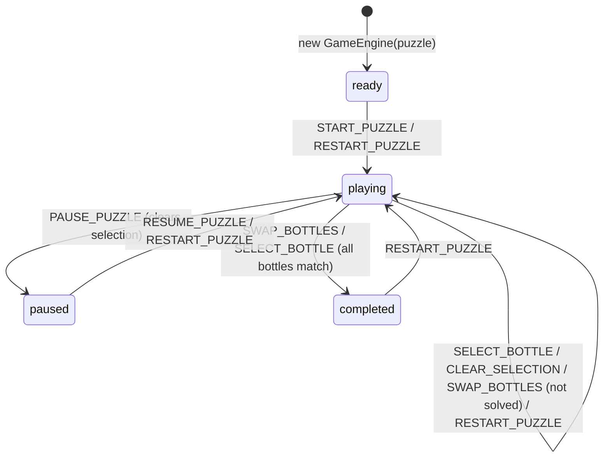

# Gameplay Engine — Bottle Shuffle

This document defines the pure TypeScript gameplay rules, immutable state model, lifecycle transitions, selection and swapping behaviour, match calculation, event contracts, public/private boundaries, and animation integration boundaries for **Bottle Shuffle** (`src/core/`).

---

## 1. Core Gameplay Rules

- Each session operates on a validated immutable `Puzzle` containing 3–10 unique bottles with an unchanged hidden `targetSequence` and an unsolved `startingSequence`.
- On every valid pairwise swap:
  1. Exchange the two bottles at the chosen logical slot indices (`BottleSwapper`).
  2. Increment `moveCount` by 1.
  3. Recalculate aggregate `currentMatchCount` (`MatchCalculator` / `countMatchingPositions`).
  4. Compute `matchDelta = currentMatchCount - previousMatchCount` (always within `[-2, +2]`).
  5. Update `bestMatchCount = Math.max(bestMatchCount, currentMatchCount)`.
  6. Clear `selectedSlotIndex` to `null`.
  7. Transition to `completed` when `currentMatchCount === totalBottleCount`.
- Correctly positioned bottles **remain movable** until the puzzle completes and are never locked or individually highlighted.

---

## 2. State Model (`PuzzleState` & `PublicGameState`)

- **`PuzzleState` (`src/core/models/PuzzleState.ts`):**
  - `puzzleId`: Stable identifier referencing the immutable `Puzzle`.
  - `currentSequence`: Frozen `readonly BottleId[]`.
  - `selectedSlotIndex`: `number | null` (0-based logical slot index).
  - `moveCount`: Non-negative integer.
  - `currentMatchCount`: Derived/synchronised aggregate match count (initialised from `puzzle.startingSequence` vs `puzzle.targetSequence`, never hardcoded to 0).
  - `bestMatchCount`: Monotonically non-decreasing session peak aggregate match count (resets to initial match count on restart).
  - `lastSwap`: Frozen `SwapResult | null`.
  - `status`: `'ready' | 'playing' | 'paused' | 'completed'`.
- **`PublicGameState` (`src/core/models/PublicGameState.ts`):**
  - Safe player-visible projection adding `totalBottleCount` and omitting `targetSequence`, `seed`, `minimumSwapDistance`, and individual matching indices.
  - Returned with freshly frozen arrays/objects so callers cannot mutate engine internals.

---

## 3. Supported Actions (`GameAction`)

Discriminated union in `src/core/models/GameAction.ts`:

- `START_PUZZLE` — Transitions `ready` → `playing`.
- `SELECT_BOTTLE { slotIndex }` — Selects a bottle, deselects if already selected, or swaps if another bottle is selected.
- `CLEAR_SELECTION` — Clears any active selection (idempotent no-op when unselected while `playing`).
- `SWAP_BOTTLES { firstIndex, secondIndex }` — Direct pairwise swap (used by future drag-and-drop; shares the exact same validation and execution path as tap-to-swap).
- `PAUSE_PUZZLE` — Transitions `playing` → `paused` and clears any active selection.
- `RESUME_PUZZLE` — Transitions `paused` → `playing`.
- `RESTART_PUZZLE` — Restores `startingSequence`, resets moves/selection/attempt metadata, keeps the same `Puzzle` and `targetSequence`, and transitions to `playing`.

---

## 4. Lifecycle State Transitions



### Disallowed & Repeated Transitions

- Any disallowed action returns `accepted: false`, preserves the exact previous `PuzzleState`, and emits a single `ACTION_REJECTED` event with a structured `ActionRejectionReason` (`PUZZLE_NOT_STARTED`, `PUZZLE_PAUSED`, `PUZZLE_ALREADY_COMPLETED`, `INVALID_SLOT_INDEX`, `IDENTICAL_SWAP_INDICES`, or `INVALID_STATE_TRANSITION`).
- Completion fires **exactly once per attempt**; subsequent actions after completion are rejected until `RESTART_PUZZLE` begins a new attempt.

---

## 5. Selection, Swap Validation & Match Calculation

- **Selection (`GameReducer.ts`):** Uses 0-based logical slot indices independent of Phaser coordinates:
  - First valid selection sets `selectedSlotIndex` without incrementing `moveCount`.
  - Selecting the same slot clears `selectedSlotIndex` without incrementing `moveCount`.
  - Selecting a different valid slot runs `executeValidatedSwap` — the exact same function invoked by `SWAP_BOTTLES`.
- **Swap validation (`SwapValidator.ts`):** Pure non-throwing checks validating `'playing'` status, finite integer bounds `[0, length - 1]`, and `firstIndex !== secondIndex`.
- **Bottle swapping (`BottleSwapper.ts`):** Pure `swapBottles(sequence, firstIndex, secondIndex)` returning a frozen new array without mutating inputs and throwing `GameError('INVALID_SWAP_INDEX')` for invalid direct calls.
- **Match calculation (`MatchCalculator.ts`):** Pure `O(n)` `calculateCorrectMatches(currentSequence, targetSequence)` validating sequence compatibility, uniqueness, and identity sets, delegating index comparison to Task 04's `countMatchingPositions`.

---

## 6. Gameplay Events (`GameEvent`)

`reduceGameState` and `GameEngine.dispatch` return an immutable `GameTransitionResult` containing `{ state, publicState, accepted, events, rejectionReason?, rejectionMessage? }` without a global event bus:

- `PUZZLE_STARTED`
- `BOTTLE_SELECTED`
- `SELECTION_CLEARED`
- `BOTTLES_SWAPPED` (`swap: SwapResult`, `currentSequence`)
- `PUZZLE_PAUSED`
- `PUZZLE_RESUMED`
- `PUZZLE_RESTARTED`
- `PUZZLE_COMPLETED` (`puzzleId`, `totalMoves`, `totalBottleCount`)
- `ACTION_REJECTED` (`actionType`, `reason`, `message`)

**Deterministic ordering:** On a winning swap, `events` is strictly ordered `[BOTTLES_SWAPPED, PUZZLE_COMPLETED]`. On pausing with an active selection, `events` is ordered `[SELECTION_CLEARED, PUZZLE_PAUSED]`.

---

## 7. Animation Integration Boundaries

- All engine state transitions are **synchronous** and free of timers or animation states.
- Each `BOTTLES_SWAPPED` event gives the presentation layer the exact exchanged slot indices (`firstIndex`, `secondIndex`), the resulting `currentSequence`, `previousMatchCount`, `currentMatchCount`, `matchDelta`, and `isCompleted`.
- The future gameplay scene will block input during swap tweens, animate `BottleSprite` movement between `BottleRack` slot coordinates, update `MatchCounter` after the swap lands, and show victory UI only after the swap animation finishes.

---

## 8. Public/Private Boundary & Error Handling

- `GameEngine` validates the supplied `Puzzle` once at construction via `assertValidPuzzle` (throwing `GameError('INVALID_PUZZLE')` on invalid puzzles) and retains a private frozen copy internally.
- Ordinary player mistakes return structured rejections (`accepted: false`) rather than throwing exceptions.
- **Client-side note:** Because Bottle Shuffle runs client-side, isolating `targetSequence` inside `GameEngine` prevents accidental disclosure through UI contracts, not inspection via browser developer tools.

---

## 9. Example Usage & Development Diagnostics

```ts
import { GameEngine, generatePuzzle } from './src/core';

const puzzle = generatePuzzle({ difficulty: 'normal', seed: 'session-1' });
const engine = new GameEngine(puzzle);

engine.start();
engine.selectBottle(0);
const swapTurn = engine.selectBottle(2);

if (swapTurn.accepted) {
  console.log(swapTurn.publicState.currentMatchCount, swapTurn.events);
}
```

Run the development-only simulation script:

```bash
npm run gameplay:simulate -- --difficulty normal --seed demo-play --reveal-target
```

---

## 10. Testing Strategy & Known Limitations

- **Unit & solver tests (`tests/unit/core/`):** Covers `MatchCalculator`, `BottleSwapper`, `SwapValidator`, `GameStateFactory`, `GameReducer`, and `GameEngine`, including programmatic cycle-guided solving of **60 deterministic puzzles across all 6 difficulties** verifying sequence preservation, match counts, `[-2, +2]` deltas, move counts, and exact completion behaviour after every swap.
- **Known limitations:** Scoring, star calculations, timers, undo, persistence, and Phaser gameplay scene wiring are intentionally deferred to subsequent tasks.
