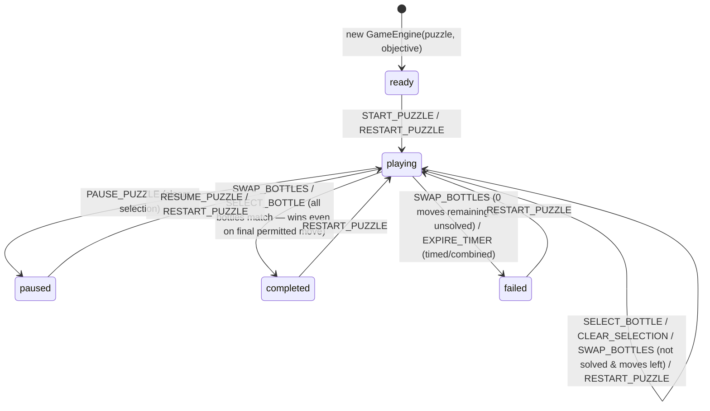

# Gameplay Engine — Bottle Shuffle

This document defines the pure TypeScript gameplay rules, immutable state model, configurable challenge objectives, lifecycle transitions, selection and swapping behaviour, match calculation, event contracts, public/private boundaries, and animation integration boundaries for **Bottle Shuffle** (`src/core/`).

---

## 1. Core Gameplay Rules

- Each session operates on a validated immutable `Puzzle` containing 3–10 unique bottles with an unchanged hidden `targetSequence` and an unsolved `startingSequence`, plus an optional validated `LevelChallengeObjective` (`classic`, `timed`, `limited_moves`, or `combined`).
- On every valid pairwise swap:
  1. Exchange the two bottles at the chosen logical slot indices (`BottleSwapper`).
  2. Increment `moveCount` by 1 and decrement `movesRemaining` by 1 when `moveLimit !== null`.
  3. Recalculate aggregate `currentMatchCount` (`MatchCalculator` / `countMatchingPositions`).
  4. Compute `matchDelta = currentMatchCount - previousMatchCount` (always within `[-2, +2]`).
  5. Update `bestMatchCount = Math.max(bestMatchCount, currentMatchCount)`.
  6. Clear `selectedSlotIndex` to `null`.
  7. Evaluate terminal outcomes in strict order:
     - **Victory takes precedence:** If `currentMatchCount === totalBottleCount`, transition immediately to `completed` (even when `movesRemaining === 0`, so solving on the final permitted move always wins).
     - **Move exhaustion:** Otherwise, if `moveLimit !== null && moveCount >= moveLimit`, transition to `failed` with `failureReason: 'moves_exhausted'`.
- Selecting or deselecting a bottle **never** consumes a move.
- Correctly positioned bottles **remain movable** until the puzzle terminates and are never locked or individually highlighted.

---

## 2. State Model (`PuzzleState` & `PublicGameState`)

- **`LevelChallengeObjective` (`src/core/models/ChallengeMode.ts`):**
  - `mode`: `'classic' | 'timed' | 'limited_moves' | 'combined'` (defaults to `{ mode: 'classic', timeLimitSeconds: null, moveLimit: null }`).
  - `timeLimitSeconds`: Positive integer for `'timed'` / `'combined'`, `null` otherwise.
  - `moveLimit`: Positive integer for `'limited_moves'` / `'combined'`, `null` otherwise. `GameEngine` validates `moveLimit >= puzzle.minimumSwapDistance` at construction so impossible levels are rejected early.
- **`PuzzleState` (`src/core/models/PuzzleState.ts`):**
  - `puzzleId`: Stable identifier referencing the immutable `Puzzle`.
  - `currentSequence`: Frozen `readonly BottleId[]`.
  - `selectedSlotIndex`: `number | null` (0-based logical slot index).
  - `moveCount`: Non-negative integer.
  - `challengeMode`: `'classic' | 'timed' | 'limited_moves' | 'combined'`.
  - `timeLimitSeconds`: `number | null`.
  - `moveLimit`: `number | null`.
  - `movesRemaining`: `number | null` (always clamped `>= 0` when `moveLimit !== null`, `null` otherwise).
  - `failureReason`: `'time_expired' | 'moves_exhausted' | null`.
  - `currentMatchCount`: Derived/synchronised aggregate match count (initialised from `puzzle.startingSequence` vs `puzzle.targetSequence`, never hardcoded to 0).
  - `bestMatchCount`: Monotonically non-decreasing session peak aggregate match count (resets to initial match count on restart).
  - `lastSwap`: Frozen `SwapResult | null`.
  - `status`: `'ready' | 'playing' | 'paused' | 'completed' | 'failed'`.
- **`PublicGameState` (`src/core/models/PublicGameState.ts`):**
  - Safe player-visible projection adding `totalBottleCount` and omitting `targetSequence`, `seed`, `minimumSwapDistance`, and individual matching indices.
  - Returned with freshly frozen arrays/objects so callers cannot mutate engine internals.

---

## 3. Supported Actions (`GameAction`)

Discriminated union in `src/core/models/GameAction.ts`:

- `START_PUZZLE` — Transitions `ready` -> `playing`.
- `SELECT_BOTTLE { slotIndex }` — Selects a bottle, deselects if already selected, or swaps if another bottle is selected.
- `CLEAR_SELECTION` — Clears any active selection (idempotent no-op when unselected while `playing`).
- `SWAP_BOTTLES { firstIndex, secondIndex }` — Direct pairwise swap sharing the exact same validation and execution path as tap-to-swap.
- `PAUSE_PUZZLE` — Transitions `playing` -> `paused` and clears any active selection.
- `RESUME_PUZZLE` — Transitions `paused` -> `playing`.
- `EXPIRE_TIMER` — Transitions `playing` -> `failed` (`failureReason: 'time_expired'`) on timed/combined levels and clears any active selection. Rejected when the puzzle has no time limit, is paused, is already completed, or is already failed.
- `RESTART_PUZZLE` — Restores `startingSequence`, resets moves, `movesRemaining`, `failureReason`, selection, and attempt metadata, keeps the same `Puzzle`, `targetSequence`, and `LevelChallengeObjective`, and transitions to `playing`.

---

## 4. Lifecycle State Transitions



### Disallowed & Repeated Transitions

- Any disallowed action returns `accepted: false`, preserves the exact previous `PuzzleState`, and emits a single `ACTION_REJECTED` event with a structured `ActionRejectionReason`:
  - `PUZZLE_NOT_STARTED`
  - `PUZZLE_PAUSED`
  - `PUZZLE_ALREADY_COMPLETED`
  - `PUZZLE_ALREADY_FAILED`
  - `MOVE_LIMIT_REACHED`
  - `INVALID_SLOT_INDEX`
  - `IDENTICAL_SWAP_INDICES`
  - `INVALID_STATE_TRANSITION`
- Both `completed` and `failed` fire **exactly once per attempt**; subsequent actions (including late `EXPIRE_TIMER` calls after completion or swaps after failure) are cleanly rejected until `RESTART_PUZZLE` begins a new attempt.

---

## 5. Selection, Swap Validation & Match Calculation

- **Selection (`GameReducer.ts`):** Uses 0-based logical slot indices independent of Phaser coordinates:
  - First valid selection sets `selectedSlotIndex` without incrementing `moveCount` or consuming `movesRemaining`.
  - Selecting the same slot clears `selectedSlotIndex` without consuming a move.
  - Selecting a different valid slot runs `executeValidatedSwap` — the exact same function invoked by `SWAP_BOTTLES`.
- **Swap validation (`SwapValidator.ts`):** Pure non-throwing checks validating `'playing'` status, rejecting `'completed'` (`PUZZLE_ALREADY_COMPLETED`), `'failed'` (`PUZZLE_ALREADY_FAILED`), exhausted move budgets (`MOVE_LIMIT_REACHED`), finite integer bounds `[0, length - 1]`, and `firstIndex !== secondIndex`.
- **Bottle swapping (`BottleSwapper.ts`):** Pure `swapBottles(sequence, firstIndex, secondIndex)` returning a frozen new array without mutating inputs and throwing `GameError('INVALID_SWAP_INDEX')` for invalid direct calls.
- **Match calculation (`MatchCalculator.ts`):** Pure `O(n)` `calculateCorrectMatches(currentSequence, targetSequence)` validating sequence compatibility, uniqueness, and identity sets, delegating index comparison to `countMatchingPositions`.

---

## 6. Gameplay Events (`GameEvent`)

`reduceGameState` and `GameEngine.dispatch` return an immutable `GameTransitionResult` containing `{ state, publicState, accepted, events, rejectionReason?, rejectionMessage? }` without a global event bus:

- `PUZZLE_STARTED`
- `BOTTLE_SELECTED`
- `SELECTION_CLEARED`
- `BOTTLES_SWAPPED` (`swap: SwapResult`, `currentSequence`)
- `PUZZLE_PAUSED`
- `PUZZLE_RESUMED`
- `PUZZLE_RESTARTED`
- `PUZZLE_COMPLETED` (`puzzleId`, `totalMoves`, `totalBottleCount`)
- `PUZZLE_FAILED` (`puzzleId`, `reason: AttemptFailureReason`, `totalMoves`, `finalMatchCount`, `totalBottleCount`)
- `ACTION_REJECTED` (`actionType`, `reason`, `message`)

**Deterministic ordering:**

- Winning swap: `[BOTTLES_SWAPPED, PUZZLE_COMPLETED]` (even when `movesRemaining === 0`).
- Move-exhausting non-winning swap: `[BOTTLES_SWAPPED, PUZZLE_FAILED]`.
- Timer expiry with an active selection: `[SELECTION_CLEARED, PUZZLE_FAILED]`.
- Pausing with an active selection: `[SELECTION_CLEARED, PUZZLE_PAUSED]`.

---

## 7. Timer Race Protection & Animation Boundaries

- All engine state transitions are **synchronous** and free of timers or Phaser animation states.
- `GameplayClock` (`src/services/GameplayClock.ts`) tracks elapsed and remaining time using an injectable monotonic clock (`performance.now()`).
- **Race-free deadline handling:**
  - Before accepting any swap tap in `GameplayController`, the controller checks whether a timed puzzle has already reached `0ms` remaining; if so, it dispatches `EXPIRE_TIMER` instead of accepting a post-deadline swap.
  - Conversely, once a valid winning swap is accepted by `GameEngine` (before the deadline), `GameplayClock.markCompleted()` freezes the clock immediately while the visual swap animation finishes, and `GameEngine` rejects any subsequent `EXPIRE_TIMER` dispatch (`PUZZLE_ALREADY_COMPLETED`). A valid winning swap never loses to a timer tick during its landing animation.
- Interrupted animations (resize, pause, suspend, failure, restart) cancel active tweens cleanly and reconcile sprite transforms to authoritative `GameEngine` slot indices.

---

## 8. Public/Private Boundary & Error Handling

- `GameEngine` validates both the supplied `Puzzle` (`assertValidPuzzle`) and `LevelChallengeObjective` (`validateChallengeObjective`, plus `moveLimit >= puzzle.minimumSwapDistance`) at construction and retains private frozen copies internally.
- `GameEngine.getCompletedScoringMetadata()` returns `{ minimumRequiredSwaps, difficulty, bottleCount }` **only** when `status === 'completed'` (never during `'playing'`, `'paused'`, or `'failed'`).
- Ordinary player mistakes return structured rejections (`accepted: false`) rather than throwing exceptions.
- **Client-side note:** Isolating `targetSequence` inside `GameEngine` prevents accidental disclosure through UI contracts, not inspection via browser developer tools.

---

## 9. Example Usage & Development Diagnostics

```ts
import { GameEngine, generatePuzzle } from './src/core';

const puzzle = generatePuzzle({ difficulty: 'normal', seed: 'session-1' });
const engine = new GameEngine(puzzle, {
  mode: 'combined',
  timeLimitSeconds: 65,
  moveLimit: 16,
});

engine.start();
engine.selectBottle(0);
const swapTurn = engine.selectBottle(2);

if (swapTurn.accepted) {
  console.log(
    swapTurn.publicState.currentMatchCount,
    swapTurn.publicState.movesRemaining,
    swapTurn.events,
  );
}
```

Run the development-only simulation script:

```bash
npm run gameplay:simulate -- --difficulty normal --seed demo-play --reveal-target
```

---

## 10. Testing Strategy

- **Unit, solver & regression tests (`tests/unit/core/`, `tests/unit/campaign/CampaignRedesignRegression.test.ts`):** Cover `MatchCalculator`, `BottleSwapper`, `SwapValidator`, `GameStateFactory`, `GameReducer`, `GameEngine`, all four challenge modes (`classic`, `timed`, `limited_moves`, `combined`), winning on the final permitted move, move exhaustion failure, timer expiry failure, timer-vs-completion race protection, and programmatic solving across all 50 campaign levels and 60 multi-tier puzzles.
