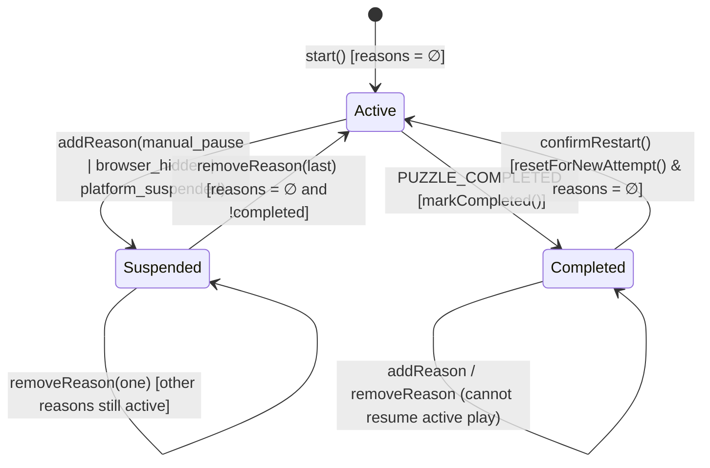

# Gameplay Lifecycle, Pause Menu, and Suspension Coordination

This document defines the central gameplay lifecycle coordinator, overlapping suspension rules, production pause menu, restart/exit confirmation flows, and clock/animation integration introduced in **Task 13**.

---

## 1. Overlapping Suspension Reasons (`GameplayLifecycleCoordinator`)

`GameplayLifecycleCoordinator` (`src/services/GameplayLifecycleCoordinator.ts`) replaces scattered boolean pause flags with an idempotent `Set<GameplaySuspensionReason>`:

- `manual_pause` — Player opened the Pause menu.
- `settings_overlay` — Gameplay Settings overlay is open on top of Pause.
- `confirmation_dialog` — Restart, Exit, or Tutorial confirmation dialog is open.
- `browser_hidden` — Window lost focus / browser tab became hidden.
- `platform_suspended` — Host `GamePlatform.onPause` fired.
- `scene_inactive` — Scene shut down or navigating away.

Gameplay (engine, active clock, and bottle input) can resume **only** when `activeReasons.size === 0` **and** `completed === false`.



### Example: Overlapping Manual Pause + Browser Tab Hide

1. Player manually pauses (`reasons = { manual_pause }`, clock frozen, `PauseOverlay` open).
2. Browser tab hides (`reasons = { manual_pause, browser_hidden }`).
3. Browser tab becomes visible (`removeReason('browser_hidden')` → `reasons = { manual_pause }`).
4. Because `manual_pause` remains active, gameplay **stays paused** and `PauseOverlay` remains open.
5. Player taps **Resume** (`removeReason('manual_pause')` → `reasons = ∅`) → `GameEngine.resume()`, `GameplayClock` resumes, and bottle input unlocks.

---

## 2. Production Pause Menu (`PauseOverlay`)

`PauseOverlay` (`src/game/components/pause/PauseOverlay.ts`, depth `940`) displays:

- Pause icon badge, `Game Paused` heading, and active level / practice label.
- `PauseStatistics` (`Moves`, `Matched X/N`, `Time MM:SS`).
- **Resume** (`PrimaryButton`), **Restart Puzzle** & **Settings** (`OutlineButton`), and restrained **Exit to Home** (`TextButton`, non-destructive styling).

Overlay z-ordering guarantees only the topmost blocking overlay receives input:

```text
Gameplay Board (0–400)
  └── VictoryOverlay (920)
  └── PauseOverlay (940)
        └── SettingsOverlay (980)
              └── Restart / Exit / Tutorial / About / Reset ConfirmDialog (1020)
```

---

## 3. Restart & Exit Confirmations

- **Restart Confirmation (`RestartConfirmation`):** Prompts `"Restart puzzle?"` explaining moves and time will reset while the secret order remains identical. Cancelling returns to `PauseOverlay` (when opened from Pause) or active play (when opened from header Restart) without losing progress. Confirming cancels stale animations, creates a fresh `attemptId`, restores the starting sequence and original target, resets moves and active time, and preserves all previously earned stars, scores, and campaign completions.
- **Exit Confirmation (`ExitConfirmation`):** Prompts `"Leave this puzzle?"` with destructive emphasis on the final confirmed **Exit to Home** button. Cancelling returns to `PauseOverlay`. Confirming stops the clock, cancels animations, abandons the incomplete attempt without awarding completion records, preserves all prior progression and settings, and navigates to `HomeScene`. Completed attempts exiting from `VictoryOverlay` do not prompt an abandonment dialog.

---

## 4. Clock, Animation, Tutorial, and Victory Integration

- **Monotonic Clock (`GameplayClock`):** Synchronised with `lifecycle.isSuspended()` via `setLifecycleSuspended()`. Time spent manually paused, in Settings, in confirmation dialogs, or while browser/platform-suspended is completely excluded (e.g., `30s active + 20s suspended + 15s active = 45s`).
- **Animation Interruption:** Pausing or suspending during an accepted swap reconciles bottle positions, match counter, and move counter via `AnimationCoordinator.cancelActiveSwap()` and `controller.completeSwapTransition()`. Accepted swaps are never undone; if an accepted swap completed the puzzle, completion is preserved and routed to `VictoryOverlay`.
- **Tutorial Mode (`TutorialController`):** Uses `GameplayLifecycleCoordinator` identically so Pause, Settings, and host suspension preserve tutorial stages, puzzles, highlights, and onboarding history.
- **Victory Mode:** Once `lifecycle.markCompleted()` runs, `canResumeGameplay()` is permanently `false` for that attempt; platform suspension preserves the committed `AttemptResult` and progression records.
- **Resource Cleanup:** `GameScene.handleShutdown()` detaches resize, platform, window, keyboard, and motion listeners, disposes `AnimationCoordinator` and scene controllers, destroys all overlays, and clears references to `undefined`. Shared `SettingsService`, `ProgressionController`, `AudioService`, `HapticService`, `SaveService`, and `SaveCoordinator` survive across scenes and dispose on `Phaser.Core.Events.DESTROY`.
- **Persistence Lifecycle (Task 15):** `SaveCoordinator` requests a best-effort `SaveService.flush()` on `platform.onPause` and retries eligible unsaved changes on `platform.onResume`. Unfinished puzzle attempts are intentionally not persisted.

---

## Viewport & Orientation Lifecycle Resilience (Task 16)

- `BrowserViewportProvider` and `ResponsiveLayoutService` coalesce resize/orientation changes on `requestAnimationFrame`, deduplicate unchanged metrics, and dispose all DOM/ResizeObserver listeners on `Phaser.Core.Events.DESTROY`.
- Viewport changes during paused gameplay preserve manual pause state and frozen `GameplayClock` elapsed time cleanly. See [RESPONSIVE_LAYOUT.md](./RESPONSIVE_LAYOUT.md).

---

## YouTube Playables Host Pause & Resume (Task 17)

- Inside YouTube Playables (`hostLifecycleControl: true`, `useBrowserVisibilityLifecycle: false`), `ytgame.system.onPause` and `ytgame.system.onResume` are the sole authoritative suspension/resumption triggers.
- `bindPlatformLifecycle()` in `src/main.ts` sleeps the Phaser loop, disables input, suspends audio/haptics, and guards Phaser's internal `VISIBLE`/`FOCUS` events so browser visibility cannot resume a host-suspended game. Manual pause (`PauseOverlay`) survives host pause/resume cycles intact. See [YOUTUBE_PLAYABLES.md](./YOUTUBE_PLAYABLES.md).

---

## Advertising Transition & Host Suspension Coordination (Task 18)

- `AdService` and `LevelTransitionCoordinator` subscribe to `GamePlatform.onPause` / `onResume` without introducing a competing lifecycle loop.
- If YouTube invokes `onPause` during an eligible Victory -> Next Level interstitial request and the SDK promise settles while suspended, `LevelTransitionCoordinator` retains the pending transition without launching gameplay prematurely and completes the single next-level launch safely upon `onResume` (supporting either callback/promise ordering).
- `RewardedAdService` likewise defers earned reward presentation until `onResume` when host-suspended. See [MONETIZATION.md](./MONETIZATION.md).
