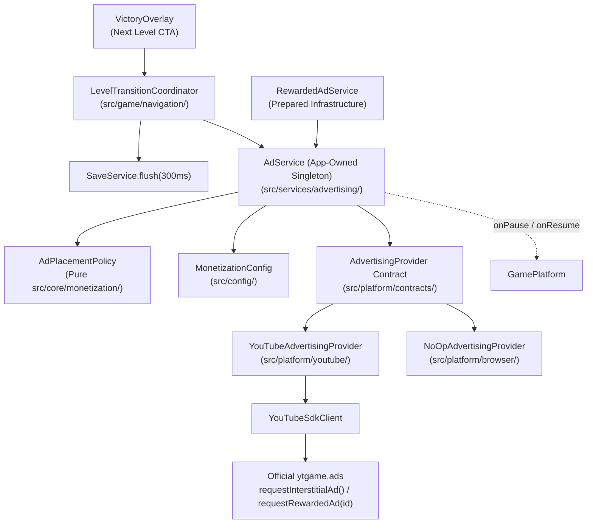
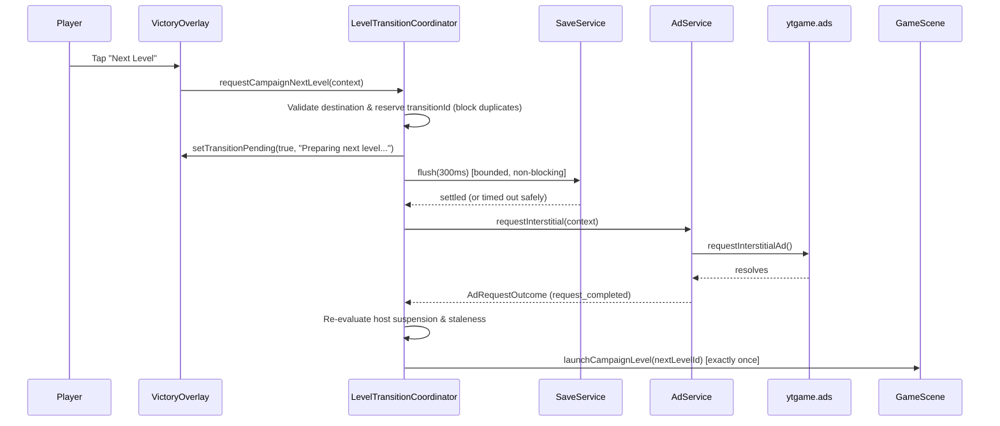
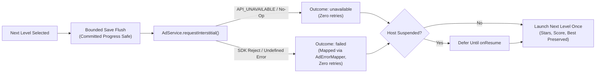
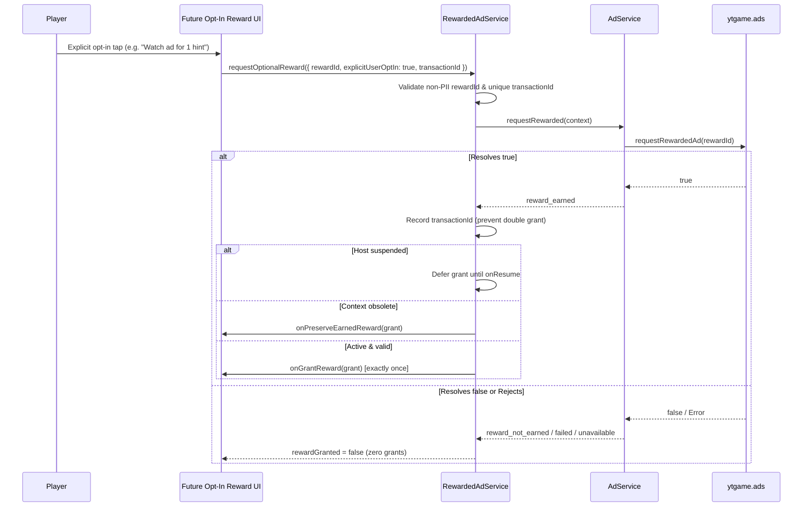

# Bottle Shuffle — Advertising & Monetisation Architecture

- **Verification Date:** 2026-11-27
- **Target Platform:** YouTube Playables SDK v1 (`https://www.youtube.com/game_api/v1`)
- **Core Invariant:** Bottle Shuffle remains 100% playable and completable across all 50 campaign levels without viewing a single advertisement.

---

## 1. Official Documentation Consulted

All monetisation decisions and SDK signatures were verified against the current English official documentation on **2026-11-27**:

- [YouTube Playables Monetization Reference](https://developers.google.com/youtube/gaming/playables/reference/monetization)
- [YouTube Playables SDK Reference](https://developers.google.com/youtube/gaming/playables/reference/sdk)
- [YouTube Playables Certification — Monetization Requirements](https://developers.google.com/youtube/gaming/playables/certification/requirements_monetization)
- [YouTube Playables Certification — Integration Requirements](https://developers.google.com/youtube/gaming/playables/certification/requirements_integration)
- [YouTube Playables Developer Portal Guide](https://developers.google.com/youtube/gaming/playables/developer_portal)
- [YouTube Playables FAQ](https://developers.google.com/youtube/gaming/playables/support/faq)
- [YouTube Advertiser-Friendly Content Guidelines](https://support.google.com/youtube/answer/6162278)

---

## 2. Supported Advertising Formats & Initial Release Strategy

| Format                                 | Management                                             | Initial Release Status                                                                                                                                        |
| :------------------------------------- | :----------------------------------------------------- | :------------------------------------------------------------------------------------------------------------------------------------------------------------ |
| **Pre-roll ads**                       | Automatically managed by YouTube on game launch        | Active on platform (cannot be disabled; **never** requested manually via SDK and no custom pre-roll screen exists)                                            |
| **Interstitial ads**                   | Requested via `ytgame.ads.requestInterstitialAd()`     | Enabled **strictly** on eligible transitions from a completed campaign Victory screen to a different accessible next campaign level                           |
| **Rewarded ads**                       | Requested via `ytgame.ads.requestRewardedAd(rewardId)` | Reusable transaction infrastructure (`RewardedAdService`) built and unit-tested; **no production rewarded buttons or hint/undo mechanics exposed** in Task 18 |
| **In-app purchases / Third-party ads** | Prohibited on YouTube Playables                        | **Strictly absent** — zero third-party ad networks (AdMob, AdSense, Unity Ads, AppLovin, Meta, IronSource), zero tracking pixels, zero IAP/currency systems   |

---

## 3. Advertising Provider Architecture

Only `src/platform/youtube/YouTubeSdkClient.ts` accesses `globalThis.ytgame.ads`. Phaser scenes, `src/core/` domain logic, and gameplay rules never reference `ytgame.ads` directly.



### Provider Implementations

- **`AdvertisingProvider` (`src/platform/contracts/AdvertisingProvider.ts`):** Minimal async contract exposing `getCapabilities()`, `requestInterstitial(placement)`, `requestRewarded(rewardId, placement)`, and `dispose()`.
- **`YouTubeAdvertisingProvider` (`src/platform/youtube/YouTubeAdvertisingProvider.ts`):** Wraps verified `ytgame.ads.requestInterstitialAd(): Promise<void>` and `ytgame.ads.requestRewardedAd(rewardId: string): Promise<boolean>` via `YouTubeSdkClient` with structured error mapping (`AdErrorMapper.ts`).
- **`NoOpAdvertisingProvider` (`src/platform/browser/NoOpAdvertisingProvider.ts`):** Default standalone browser provider. Returns `unavailable` immediately with zero latency, zero external calls, zero ad claims, and zero reward grants.

### Capability Detection vs. Ad Delivery

`PlatformCapabilities` exposes explicit technical flags (`advertising`, `advertisingEnabled`, `interstitialAds`, `rewardedAds`). Technical presence of `ytgame.ads.requestInterstitialAd` or `ytgame.ads.requestRewardedAd` confirms **only** that the SDK method exists in the Playables runtime — it **never** guarantees ad fill, player ad eligibility, Developer Portal monetisation approval, or revenue-sharing qualification. Bottle Shuffle never inspects private YouTube account attributes and delegates all delivery/frequency decisions to YouTube.

---

## 4. Centralised `AdService`, Configuration & Request State

- **Single Application Owner:** `AdService` and `RewardedAdService` are instantiated once in `src/main.ts` and disposed on `Phaser.Core.Events.DESTROY`. No scene constructs its own advertising service.
- **Application Configuration (`src/config/MonetizationConfig.ts`):** Centralised policy flags (`advertisingEnabled`, `interstitialEnabled`, `rewardedInfrastructureEnabled`, `rewardedUiExposedInProduction: false`, `tutorialAdsDisabled: true`, `practiceAdsDisabled: true`, `activeGameplayAdsDisabled: true`, `pauseAdsDisabled: true`, `restartAndReplayAdsDisabled: true`). These are application configuration settings, not player preferences.
- **Request State (`src/services/advertising/AdRequestState.ts`):** Explicitly models `idle | requesting | settled | failed | disposed`. Intentionally omits an unverified `ad_playing` state because the SDK does not expose an ad-impression or ad-playback event.
- **Concurrency & Duplicate Protection:** `AdService` enforces a strict single-active-request lock (`activeRequestId`) blocking simultaneous interstitial and rewarded calls (`status: 'busy'`) and discards stale/post-disposal callbacks safely.
- **Delayed Response Watchdog:** `AdService` runs an optional diagnostic-only watchdog timer (`delayedResponseWatchdogMs`). Because `ytgame.ads` does not support request cancellation, the watchdog **never** cancels a host request, **never** launches gameplay behind an active host ad, and **never** issues a second request while the first remains unresolved.

---

## 5. Placement Policy

Implemented purely in `src/core/monetization/AdPlacementPolicy.ts` (zero Phaser/DOM/SDK dependencies).

### Eligible Interstitial Placements (Initial Release)

An interstitial request is eligible **only** when every condition holds:

1. `advertisingEnabled && interstitialEnabled` are true in `MonetizationConfig`.
2. Application is not host-suspended (`!hostSuspended`).
3. Mode is `campaign` (never `tutorial`, never `practice`).
4. Trigger is `next_level` from a presented Victory screen after the puzzle was completed and progression was committed.
5. Destination level ID is valid, accessible via `ProgressionController`, and strictly different from the completed level.
6. At chapter boundaries, chapter transition and level transition are **coalesced** into a single `chapter_transition` opportunity (`coalescedChapterTransition: true`) — never two requests.

### Strictly Ineligible Placements

Interstitials are **never** requested during active puzzle solving, bottle selection, swap/match animations, manual pause/resume, settings changes, confirmation cancel, tutorial mode, practice mode, viewport resize, game boot/load, restarting an unfinished puzzle, replaying the same level, elapsed gameplay timers, or returning to Home/Level Selection.

---

## 6. Interstitial Integration Flow & Navigation Protection



### Failure Recovery Flow



### Host Lifecycle Interruption Flow

```mermaid
sequenceDiagram
    participant LTC as LevelTransitionCoordinator
    participant AdSvc as AdService
    participant Host as YouTube Host (onPause / onResume)
    participant Game as Phaser Loop & AudioService

    LTC->>AdSvc: requestInterstitial()
    Host->>Game: onPause()
    Game->>Game: Suspend audio, input, and loop
    Host->>LTC: onPause() -> hostSuspended = true
    AdSvc-->>LTC: request settles while suspended
    LTC->>LTC: Mark readyToLaunch = true (DO NOT launch yet)
    Host->>Game: onResume()
    Game->>Game: Wake loop; re-evaluate host audio & player settings
    Host->>LTC: onResume() -> hostSuspended = false
    LTC->>LTC: Launch destination level exactly once
```

_(If `onResume` arrives before the SDK promise settles, `hostSuspended` is already `false` when the promise resolves, so `LevelTransitionCoordinator` proceeds cleanly in either callback order.)_

---

## 7. Audio, Timer & Persistence Protection

- **Audio Authority:** `AudioService` preserves YouTube host mute (`ytgame.system.isAudioEnabled()` / `onAudioEnabledChange`) as strictly authoritative across ad transitions. Settling an ad request never unmutes a host-muted or user-muted game, and Bottle Shuffle never attempts to control advertisement audio.
- **Timer Immutability:** Completed `AttemptResult` records are frozen before Victory appears. Time spent viewing Victory, awaiting a transition, or suspended during an ad never mutates the previous attempt and never bleeds into the next level's fresh `GameplayClock`.
- **Save Protection:** Progression is committed and critical save requested before the Victory overlay opens. `LevelTransitionCoordinator` performs a bounded `saveService.flush(300)` before calling `AdService`, and a failed save flush or failed ad never relocks a completed level or blocks ordinary progression.

---

## 8. Rewarded Advertising Infrastructure & Deferred Mechanics

`RewardedAdService` (`src/services/advertising/RewardedAdService.ts`) provides a reusable, opt-in transaction boundary ready for future explicitly approved assistance features without exposing any unfinished UI in Task 18 (`rewardedUiExposedInProduction: false`).



### Deferred Reward Mechanics Boundary

Potential future mechanics (revealing one correct position, suggesting one swap, or limited swap undo) are intentionally **not implemented** in Task 18. Before implementing any future assistance feature, design decisions must define scoring impact, personal-best eligibility, ad-free availability, cross-attempt persistence, and fairness guarantees. The advertising layer never accesses or exposes hidden target bottle sequences.

### Reward Identifiers & Privacy Restrictions

- Reward IDs are validated by `validateRewardIdentifier()` (`^[a-zA-Z0-9][a-zA-Z0-9._-]{2,63}$`) to guarantee non-PII readable strings or standard UUIDs (e.g., reserved examples `bottle-shuffle.optional-hint.v1`, `bottle-shuffle.optional-assistance.v1`).
- Bottle Shuffle collects **zero** user identities, advertising identifiers, device fingerprints, locations, behavioural profiles, external telemetry, or save payloads inside ad requests.

---

## 9. Advertiser-Friendly Content Review

Reviewed against YouTube's **Advertiser-Friendly Content Guidelines** (2026-11-27):

| Element                      | Audit Finding                                                                                                                                                                                 | Potential Review Note                                                                                |
| :--------------------------- | :-------------------------------------------------------------------------------------------------------------------------------------------------------------------------------------------- | :--------------------------------------------------------------------------------------------------- |
| **Title (`Bottle Shuffle`)** | Neutral casual deduction puzzle title.                                                                                                                                                        | "Bottle" alone is neutral; no drinking, bar, or intoxication terminology appears anywhere.           |
| **Bottle Assets**            | 10 bright, stylised, colour-coded + geometric-symbol puzzle bottles (circle, diamond, triangle, star, etc.) on a wooden shelf.                                                                | Clearly read as abstract puzzle pieces rather than alcoholic beverages or real-world alcohol brands. |
| **Imagery, UI & Copy**       | Tutorial ("Swap bottles to match the hidden order"), Victory ("Perfect Shuffle!", "Chapter Complete"), and Settings copy contain zero alcohol, gambling, or real-world cash/prize references. | Low risk; maintain abstract puzzle framing in future promotional key art and store descriptions.     |
| **Audio**                    | Original soft chimes, wooden clinks, and upbeat instrumental background loops.                                                                                                                | Family-friendly and completely original.                                                             |

> **Important:** Automated review confirms alignment with guidelines, but **does not constitute official YouTube advertiser-friendly approval**, which occurs only during actual Developer Portal review.

---

## 10. Developer Portal Configuration & Eligibility

### Recommended Portal Configuration Steps (Manual Partner Action)

1. **Access:** Sign in to the YouTube Playables Developer Portal via YouTube Studio with appropriate Channel Manager/Editor permissions for an approved Playables release.
2. **Pre-roll Advertising:** Automatically managed by YouTube on launch; cannot be toggled off and requires zero developer SDK code.
3. **Interstitial Advertising:** Enable interstitial advertising on the release once staging verification and monetisation review succeed.
4. **Rewarded Advertising:** Keep **disabled** in the Developer Portal for the initial release until a production optional reward mechanic is implemented and reviewed.
5. **Testing & Review:** Validate the release in staging / Playables SDK Test Suite, submit for certification and advertiser-friendly content review.

### Monetisation & Revenue-Sharing Eligibility Limitations

- Enabling monetisation toggles in the Developer Portal **does not guarantee** revenue-sharing eligibility, ad fill, or payouts.
- Revenue sharing on YouTube Playables is subject to YouTube's active partner/creator eligibility programs and current platform terms.
- Bottle Shuffle contains **no** in-game revenue/CPM/impression estimation dashboard; all reporting belongs strictly in the official Developer Portal.

---

## 11. Testing Strategy & Known Limitations

- **Unit & Integration Coverage:** Deterministic Vitest suites (`tests/unit/advertising/*`, `tests/integration/AdvertisingIntegration.test.ts`) using isolated `MockAdvertisingProvider` and `MockYouTubeSdk` (strictly excluded from production bundles).
- **Development Diagnostics:** `?scene=ads` (`AdvertisingShowcaseScene`) dynamically imported only inside `if (import.meta.env.DEV)` and verified absent from `dist/`.
- **Known Limitations:**
  - `ytgame.ads` does not expose impression confirmation, revenue telemetry, or request cancellation APIs.
  - Live ad fill, real YouTube host suspension timing during live ads, and official Test Suite verification require an interactive signed-in session in Google's Playables Test Suite / Developer Portal staging environment.
