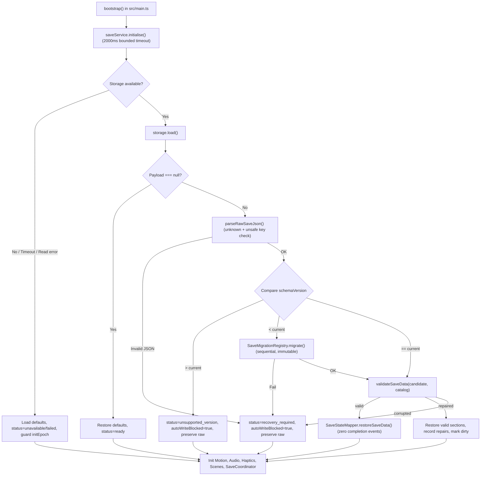
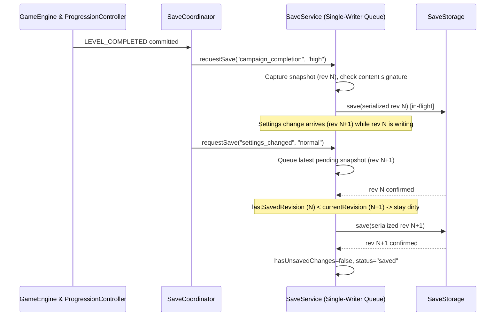
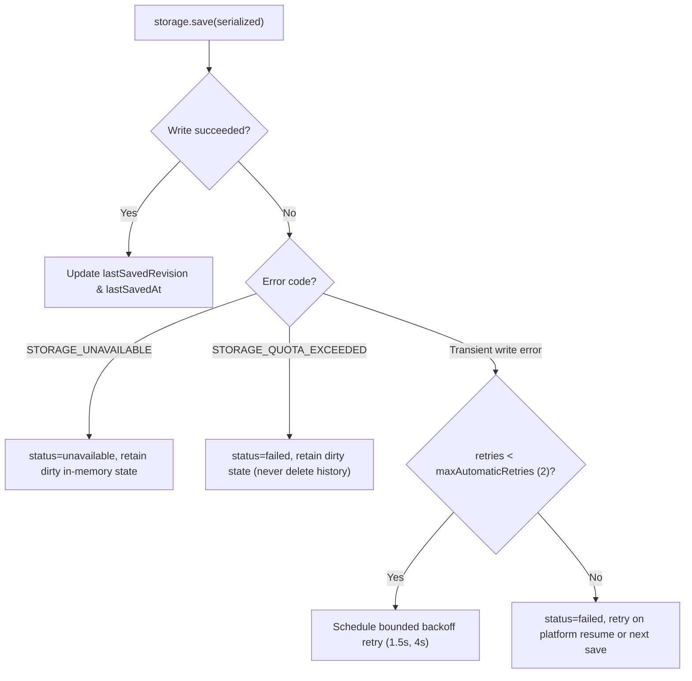

# Progress Persistence and Save-Data Architecture (`docs/PERSISTENCE.md`)

Bottle Shuffle implements a versioned, validated, platform-independent save-data persistence architecture designed for reliable standalone browser storage today and clean adapter substitution for **YouTube Playables** in **Task 17**.

---

## 1. Architecture & Ownership

Persistence follows strict Dependency Inversion and separation of concerns:

- **Pure Domain (`src/core/persistence/`):**
  - `SaveSchemaVersion.ts` (`CURRENT_SAVE_SCHEMA_VERSION = 1`, `SAVE_GAME_ID = 'bottle-shuffle'`)
  - `SaveData.ts`, `SaveMetadata.ts`, `SaveError.ts`, `SaveValidationResult.ts`
  - `SaveDataFactory.ts` (delegates to existing `createDefaultGameSettings()` rather than duplicating defaults)
  - `SaveDataValidator.ts` (reuses `LevelCatalog`, `isEarnedStarRating`, `isMotionPreference`, and enforces campaign prerequisite consistency and unsafe-key rejection)
  - Zero imports from Phaser, browser globals, `localStorage`, or `ytgame`.
- **Platform Storage Boundary (`src/platform/`):**
  - `contracts/SaveStorage.ts`: Asynchronous platform-independent `SaveStorage` contract (`load`, `save`, `isAvailable`, optional `remove`, optional `onExternalChange`).
  - `browser/BrowserSaveStorage.ts`: Standalone browser adapter using `localStorage` under key `bottle-shuffle.save`. All direct `localStorage` access is strictly confined to this adapter.
  - `memory/InMemorySaveStorage.ts`: Deterministic in-memory adapter used by unit/integration tests and isolated dev diagnostics (`SaveShowcaseScene`).
- **Application Services (`src/services/persistence/`):**
  - `SaveSerializer.ts`: Compact JSON serialization, safe `unknown`-based parsing, content signature comparison, and UTF-8 byte sizing.
  - `SaveMigrationRegistry.ts`: Deterministic sequential `v -> v + 1` schema migration pipeline that never mutates inputs.
  - `SaveStateMapper.ts`: Converts between `SaveData` and live authoritative services (`ProgressionController`, `SettingsService`, `TutorialPreferenceService`) without recalculating scores or replaying first-time completion events.
  - `SaveStatus.ts`: Structured immutable `SaveStatusSnapshot` (`initialising`, `ready`, `dirty`, `saving`, `saved`, `unavailable`, `failed`, `recovery_required`, `unsupported_version`, `conflict`).
  - `SaveService.ts`: Single application-owned instance created in `src/main.ts`, managing startup restoration, debounced & high-priority saving, single-writer serialized queueing, revision coalescing, multi-tab conflict detection, and bounded retries.
  - `SaveCoordinator.ts`: Connects `ProgressionController`, `SettingsService`, `TutorialPreferenceService`, and `GamePlatform` pause/resume lifecycle to `SaveService`.
- **Unobtrusive UI Feedback (`src/game/components/persistence/SaveStatusToastCoordinator.ts`):**
  - Displays a non-blocking warning toast at most once per distinct issue (`unavailable`, `recovery_required`, `unsupported_version`, `conflict`) using the existing Design System `Toast`.

---

## 2. Save-Data Schema (`schemaVersion: 1`)

`SaveData.schemaVersion` (`1`) is the single authoritative persisted save version. Nested domain versions (`PROGRESSION_SCHEMA_VERSION = 1`, `SETTINGS_SCHEMA_VERSION = 1`) are populated by `SaveStateMapper` when hydrating domain objects.

### Example Valid Serialized Save

```json
{
  "schemaVersion": 1,
  "gameId": "bottle-shuffle",
  "revision": 7,
  "updatedAt": "2026-11-27T10:00:00.000Z",
  "progression": {
    "completedLevels": {
      "level-001": {
        "completionCount": 2,
        "bestMoveCount": 2,
        "bestElapsedMs": 14200,
        "bestScore": 1000,
        "bestStarRating": 3,
        "scoringPolicyVersion": 1
      },
      "level-002": {
        "completionCount": 1,
        "bestMoveCount": 4,
        "bestElapsedMs": 24800,
        "bestScore": 860,
        "bestStarRating": 2,
        "scoringPolicyVersion": 1
      }
    },
    "lastPlayedLevelId": "level-002"
  },
  "settings": {
    "musicEnabled": false,
    "soundEffectsEnabled": true,
    "vibrationEnabled": false,
    "motionPreference": "reduced"
  },
  "tutorial": {
    "status": "completed",
    "completed": true
  }
}
```

### Persisted vs Non-Persisted Data

- **Persisted:** Completed level records (`completionCount`, `bestMoveCount`, `bestElapsedMs`, optional `bestScore`, `bestStarRating`, `scoringPolicyVersion`), `lastPlayedLevelId`, player settings (`musicEnabled`, `soundEffectsEnabled`, `vibrationEnabled`, `motionPreference`), tutorial onboarding state (`status`: `'not_seen' | 'completed' | 'skipped'` + consistent `completed` boolean), and metadata (`schemaVersion`, `gameId`, `revision`, `updatedAt`).
- **Derived (never persisted):** Unlocked levels, unlocked chapters, chapter/campaign percentages, total earned stars, total best score, recommended next level, campaign/perfect completion flags. All are derived dynamically by `ProgressionEngine` from `LevelCatalog` + `completedLevels`.
- **Never persisted:** Phaser objects, textures, animations, audio instances, listeners, active modals, temporary bottle selection, static `LevelCatalog`, hidden target sequences, RNG internals, Practice mode results, or **unfinished gameplay attempts**.

### Unfinished Attempts Policy

Unfinished campaign attempts are intentionally **not persisted** in this release. Closing or reloading mid-puzzle preserves all previously completed levels, historical personal bests, earned stars, settings, and tutorial completion status. Launching that level again deterministically generates the same puzzle from `LevelCatalog` with zero moves, zero active time, and no selected bottle.

---

## 3. Startup Restoration Flow

`src/main.ts` awaits `saveService.initialise()` alongside `platform.initialize()` and local font loading **before** creating `MotionPreferenceService`, `AudioService`, `HapticService`, `LevelUnlockTracker`, and Phaser scenes. Restored preferences and progression are active before the first Home frame renders.



---

## 4. Automatic Saving & Concurrent Write Protection

- **High Priority (immediate, bypasses debounce):** Campaign level completion (`LEVEL_COMPLETED`, `CHAPTER_COMPLETED`, `CAMPAIGN_COMPLETED`), record improvement (`LEVEL_RECORD_IMPROVED`), and tutorial completion/skip (`tutorial_completion`).
- **Normal Priority (300 ms debounce):** Player settings changes (`settings_changed`) and `lastPlayedLevelId` updates (`last_played_changed`).
- **Deduplication:** `computeSaveContentSignature()` ignores `revision` and `updatedAt` so identical persisted state never triggers redundant writes.
- **Single-Writer Queue:** At most one `storage.save()` promise runs at any time. If revisions 11 and 12 arrive while revision 10 is in flight, revision 10's completion never marks the service `'saved'`; instead, the queue immediately persists the single coalesced revision 12 snapshot.



---

## 5. Failure Handling, Recovery & Multi-Tab Policy



- **Corrupted or Unsupported Future Saves:** Never automatically overwritten (`autoWriteBlocked = true`). The player can keep playing in a temporary session while their stored data remains intact. Starting a fresh persistent save requires an explicit confirmed reset (`SaveService.resetStorageForFreshStart()`).
- **Multiple Browser Tabs:** `BrowserSaveStorage` listens to `window` `'storage'` events for `bottle-shuffle.save`. If another tab writes a strictly higher `revision`, `SaveService` transitions to `status: 'conflict'` and sets `autoWriteBlocked = true` rather than silently overwriting newer progress from another tab (safe single-writer session policy).
- **Browser Lifecycle:** `SaveCoordinator` requests a best-effort `flush()` on `platform.onPause` and retries eligible unsaved changes on `platform.onResume`. Critical progress is saved immediately when committed rather than relying on `beforeunload`.

---

## 6. Measured Save-Data Sizes & Privacy

Measured directly using UTF-8 byte encoding (`TextEncoder`):

| Scenario                                                              |        Measured UTF-8 Size | % of 32 KiB Internal Target |
| --------------------------------------------------------------------- | -------------------------: | --------------------------: |
| Empty default campaign (fresh install)                                |   **323 bytes** (0.32 KiB) |                        1.0% |
| Fully completed 50-level campaign (all records, scores, stars, times) | **7,080 bytes** (6.91 KiB) |                       21.6% |

- **Privacy:** Zero PII is stored (no names, emails, credentials, device/ad IDs, or location).
- **Untrusted Input:** All loaded data is parsed as `unknown`, checked for prohibited object keys (`__proto__`, `constructor`, `prototype`), and validated before hydration. Client-side JSON is for reliability and portability, not tamper-proof encryption.

---

## 7. Development Diagnostics & Deferred Work

- **Dev Showcase (`?scene=save`):** `SaveShowcaseScene` (dynamically imported inside `import.meta.env.DEV` and excluded from production builds) inspects live status, sizes, and simulates valid fixtures, missing saves, corrupt JSON, invalid settings, future `v99` schemas, write failures, delayed writes, and resets against an **isolated `InMemorySaveStorage`** without touching player `localStorage`.
- **YouTube Playables Storage (Task 17):** Standalone browser `LocalStorage` is used for local web development only. Task 17 will implement the verified YouTube Playables storage adapter behind `SaveStorage` and verify actual platform storage limits.

---

## YouTube Playables Cloud Persistence (Task 17)

- Inside YouTube Playables (`ytgame.IN_PLAYABLES_ENV === true`), `YouTubeSaveStorage` (`src/platform/youtube/YouTubeSaveStorage.ts`) is used exclusively via `ytgame.game.loadData()` and `ytgame.game.saveData(data)` — browser LocalStorage, SessionStorage, IndexedDB, and cookies are never accessed.
- Enforces mandatory load-before-save state protection (`not_initialised` / `loading` / `loaded` / `load_failed` / `disposed`), double-guarded by `SaveService` (`requiresLoadBeforeSave: true`), plus pre-SDK well-formed UTF-16 validation and 3 MiB payload bounds. See [YOUTUBE_PLAYABLES.md](./YOUTUBE_PLAYABLES.md).

---

## Save Protection Before Advertising Transitions (Task 18)

- Campaign level completion results (stars, score, personal bests, unlocks) are committed to `ProgressionController` and queued as high-priority saves in `SaveService` **before** the Victory screen opens.
- When the player selects **Next Level**, `LevelTransitionCoordinator` performs a bounded `saveService.flush(300)` prior to requesting an eligible interstitial; a save timeout or storage failure never blocks next-level navigation and an ad failure never reverts committed records. See [MONETIZATION.md](./MONETIZATION.md).
