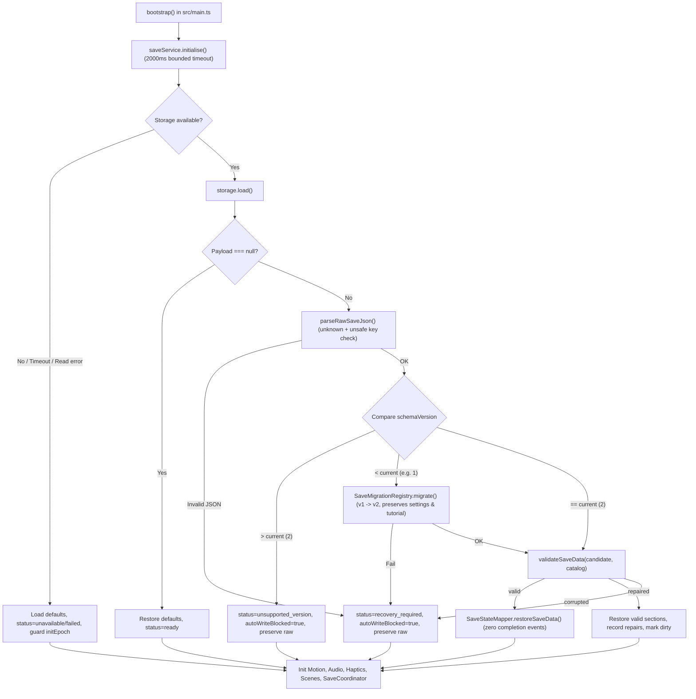

# Progress Persistence and Save-Data Architecture (`docs/PERSISTENCE.md`)

Bottle Shuffle implements a versioned, validated, platform-independent save-data persistence architecture supporting standalone browser storage (`LocalStorage`) and exclusive **YouTube Playables** cloud storage (`ytgame.game.loadData` / `saveData`).

---

## 1. Architecture & Ownership

Persistence follows strict Dependency Inversion and separation of concerns:

- **Pure Domain (`src/core/persistence/`):**
  - `SaveSchemaVersion.ts` (`CURRENT_SAVE_SCHEMA_VERSION = 2`, `MIN_SUPPORTED_SAVE_SCHEMA_VERSION = 1`, `CURRENT_CAMPAIGN_CATALOG_VERSION = '2.0.0'`, `SAVE_GAME_ID = 'bottle-shuffle'`)
  - `SaveData.ts`, `SaveMetadata.ts`, `SaveError.ts`, `SaveValidationResult.ts`
  - `SaveDataFactory.ts` (delegates to `createDefaultGameSettings()`)
  - `SaveDataValidator.ts` (reuses `LevelCatalog`, `isEarnedStarRating`, `isMotionPreference`, `CHALLENGE_INTRO_MODES`, enforces campaign prerequisite consistency, validates `campaignCatalogVersion`, and rejects unsafe prototype keys)
  - Zero imports from Phaser, browser globals, `localStorage`, or `ytgame`.
- **Platform Storage Boundary (`src/platform/`):**
  - `contracts/SaveStorage.ts`: Asynchronous platform-independent `SaveStorage` contract (`load`, `save`, `isAvailable`, optional `remove`, optional `onExternalChange`).
  - `browser/BrowserSaveStorage.ts`: Standalone browser adapter using `localStorage` under key `bottle-shuffle.save`. All direct `localStorage` access is strictly confined to this adapter.
  - `youtube/YouTubeSaveStorage.ts`: Exclusive YouTube Playables cloud storage adapter via `ytgame.game.loadData()` and `ytgame.game.saveData(data)`.
  - `memory/InMemorySaveStorage.ts`: Deterministic in-memory adapter used by unit/integration tests and isolated dev diagnostics (`SaveShowcaseScene`).
- **Application Services (`src/services/persistence/`):**
  - `SaveSerializer.ts`: Compact JSON serialization, safe `unknown`-based parsing, content signature comparison, and UTF-8 byte sizing.
  - `SaveMigrationRegistry.ts`: Deterministic sequential `v -> v + 1` schema migration pipeline (currently registering `MIGRATE_V1_TO_V2_CAMPAIGN_REDESIGN`) that never mutates inputs.
  - `SaveStateMapper.ts`: Converts between `SaveData` and live authoritative services (`ProgressionController`, `SettingsService`, `TutorialPreferenceService`, `ChallengeIntroService`) without recalculating scores or replaying first-time completion events.
  - `SaveStatus.ts`: Structured immutable `SaveStatusSnapshot` (`initialising`, `ready`, `dirty`, `saving`, `saved`, `unavailable`, `failed`, `recovery_required`, `unsupported_version`, `conflict`).
  - `SaveService.ts`: Single application-owned instance created in `src/main.ts`, managing startup restoration, debounced & high-priority saving, single-writer serialized queueing, revision coalescing, multi-tab conflict detection, and bounded retries.
  - `SaveCoordinator.ts`: Connects `ProgressionController`, `SettingsService`, `TutorialPreferenceService`, `ChallengeIntroService`, and `GamePlatform` pause/resume lifecycle to `SaveService`.
- **Unobtrusive UI Feedback (`src/game/components/persistence/SaveStatusToastCoordinator.ts`):**
  - Displays a non-blocking warning toast at most once per distinct issue (`unavailable`, `recovery_required`, `unsupported_version`, `conflict`) using the existing Design System `Toast`.

---

## 2. Save-Data Schema (`schemaVersion: 2`)

`SaveData.schemaVersion` (`2`) is the single authoritative persisted save version, paired with `campaignCatalogVersion` (`'2.0.0'`) to bind stored campaign records explicitly to the redesigned 50-level campaign structure.

### Example Valid Serialized Save (`v2`)

```json
{
  "schemaVersion": 2,
  "campaignCatalogVersion": "2.0.0",
  "gameId": "bottle-shuffle",
  "revision": 7,
  "updatedAt": "2026-11-27T10:00:00.000Z",
  "progression": {
    "completedLevels": {
      "level-001": {
        "completionCount": 2,
        "bestMoveCount": 1,
        "bestElapsedMs": 8200,
        "bestScore": 1000,
        "bestStarRating": 3,
        "scoringPolicyVersion": 1
      },
      "level-002": {
        "completionCount": 1,
        "bestMoveCount": 4,
        "bestElapsedMs": 18800,
        "bestScore": 938,
        "bestStarRating": 3,
        "scoringPolicyVersion": 1
      }
    },
    "lastPlayedLevelId": "level-002"
  },
  "settings": {
    "musicEnabled": false,
    "soundEffectsEnabled": true,
    "vibrationEnabled": false,
    "motionPreference": "reduced"
  },
  "tutorial": {
    "status": "completed",
    "completed": true
  },
  "seenChallengeIntros": ["timed"]
}
```

### Schema `v1 -> v2` Migration Policy (Campaign Redesign)

Because Bottle Shuffle has **not been publicly released** (only internal pre-release `1.0.0-rc.1` existed prior to the Campaign Progression Redesign), `level-001`..`level-050` in Catalogue `v2.0.0` represent materially different bottle counts, seeds, and challenge modes (timed, limited-moves, combined) than pre-redesign `v1` development saves.

- **`MIGRATE_V1_TO_V2_CAMPAIGN_REDESIGN` (`SaveMigrationRegistry.ts`):**
  - Upgrades `schemaVersion: 1` -> `schemaVersion: 2` and stamps `campaignCatalogVersion: '2.0.0'`.
  - **Preserves** player `settings` (music, SFX, vibration, motion preference) and `tutorial` completion status.
  - **Resets** pre-redesign `v1` `progression.completedLevels` and `lastPlayedLevelId` rather than silently binding old `v1` records to materially different `v2` levels.
  - Initialises `seenChallengeIntros: []` so players see the concise introduction the first time they reach Timed, Limited Moves, and Combined chapters.
- **Catalog Version Guard (`SaveDataValidator.ts`):** Even within `schemaVersion: 2`, if a future or mismatched `campaignCatalogVersion` is detected during validation, incompatible progression records are cleanly reset and flagged for repair rather than silently attached to mismatched level definitions.
- **Post-Launch Compatibility Commitment:** Once Bottle Shuffle is publicly live on YouTube Playables, future campaign updates must preserve player progression across schema changes (for example by appending new chapters or archiving legacy chapter records rather than resetting completed live progress).

### Persisted vs Non-Persisted Data

- **Persisted:** Completed level records (`completionCount`, `bestMoveCount`, `bestElapsedMs`, optional `bestScore`, `bestStarRating`, `scoringPolicyVersion`), `lastPlayedLevelId`, player settings (`musicEnabled`, `soundEffectsEnabled`, `vibrationEnabled`, `motionPreference`), tutorial onboarding state (`status`: `'not_seen' | 'completed' | 'skipped'` + consistent `completed` boolean), `seenChallengeIntros` (unique subset of `'timed' | 'limited_moves' | 'combined'`), and metadata (`schemaVersion`, `campaignCatalogVersion`, `gameId`, `revision`, `updatedAt`).
- **Derived (never persisted):** Unlocked levels, unlocked chapters, chapter/campaign percentages, total earned stars, total best score, recommended next level, campaign/perfect completion flags. All are derived dynamically by `ProgressionEngine` from `LevelCatalog` + `completedLevels`.
- **Never persisted:** Phaser objects, textures, animations, audio instances, listeners, active modals, temporary bottle selection, static `LevelCatalog`, hidden target sequences, RNG internals, Practice mode results, **failed attempts**, or **unfinished gameplay attempts**.

### Unfinished & Failed Attempts Policy

Unfinished and failed campaign attempts are intentionally **not persisted**. Closing, reloading, or failing mid-puzzle preserves all previously completed levels, historical personal bests, earned stars, settings, tutorial state, and seen challenge introductions. Retrying or relaunching that level deterministically generates the same puzzle from `LevelCatalog` with zero moves, full time/move allowances, and no selected bottle.

---

## 3. Startup Restoration Flow

`src/main.ts` awaits `saveService.initialise()` alongside `platform.initialize()` and local font loading **before** creating `MotionPreferenceService`, `AudioService`, `HapticService`, `LevelUnlockTracker`, and Phaser scenes. Restored preferences, challenge-intro flags, and progression are active before the first Home frame renders.



---

## 4. Automatic Saving & Concurrent Write Protection

- **High Priority (immediate, bypasses debounce):** Campaign level completion (`LEVEL_COMPLETED`, `CHAPTER_COMPLETED`, `CAMPAIGN_COMPLETED`), record improvement (`LEVEL_RECORD_IMPROVED`), and tutorial completion/skip (`tutorial_completion`).
- **Normal Priority (300 ms debounce):** Player settings changes (`settings_changed`), challenge intro dismissal (`challenge_intro_seen`), and `lastPlayedLevelId` updates (`last_played_changed`).
- **Deduplication:** `computeSaveContentSignature()` ignores `revision` and `updatedAt` so identical persisted state never triggers redundant writes.
- **Single-Writer Queue:** At most one `storage.save()` promise runs at any time. Pending mutations arriving mid-write are coalesced into a single follow-up snapshot.

---

## 5. Failure Handling, Recovery & Multi-Tab Policy

- **Corrupted or Unsupported Future Saves:** Never automatically overwritten (`autoWriteBlocked = true`). The player can keep playing in a temporary session while stored data remains intact. Starting a fresh persistent save requires an explicit confirmed reset (`SaveService.resetStorageForFreshStart()`).
- **Multiple Browser Tabs:** `BrowserSaveStorage` listens to `window` `'storage'` events for `bottle-shuffle.save`. If another tab writes a strictly higher `revision`, `SaveService` transitions to `status: 'conflict'` and sets `autoWriteBlocked = true`.
- **Browser Lifecycle:** `SaveCoordinator` requests a best-effort `flush()` on `platform.onPause` and retries eligible unsaved changes on `platform.onResume`.

---

## 6. Measured Save-Data Sizes & Privacy (`schemaVersion: 2`)

Measured directly using UTF-8 byte encoding (`TextEncoder`) via `npm run validate:campaign`:

| Scenario                                                              |        Measured UTF-8 Size | % of 32 KiB Internal Target |
| --------------------------------------------------------------------- | -------------------------: | --------------------------: |
| Empty default campaign (fresh install, `0/50`)                        |   **415 bytes** (0.41 KiB) |                        1.3% |
| Mid campaign (`25/50` completed + challenge intros)                   | **3,796 bytes** (3.71 KiB) |                       11.6% |
| Fully completed 50-level campaign (all records, scores, stars, times) | **7,171 bytes** (7.00 KiB) |                       21.9% |

- **Privacy:** Zero PII is stored (no names, emails, credentials, device/ad IDs, or location).
- **Untrusted Input:** All loaded data is parsed as `unknown`, checked for prohibited object keys (`__proto__`, `constructor`, `prototype`), and validated before hydration.

---

## 7. YouTube Playables Cloud Persistence & Ad Transitions

- Inside YouTube Playables (`ytgame.IN_PLAYABLES_ENV === true`), `YouTubeSaveStorage` (`src/platform/youtube/YouTubeSaveStorage.ts`) is used exclusively via `ytgame.game.loadData()` and `ytgame.game.saveData(data)` — browser LocalStorage, SessionStorage, IndexedDB, and cookies are never accessed.
- Enforces mandatory load-before-save state protection (`not_initialised` / `loading` / `loaded` / `load_failed` / `disposed`), double-guarded by `SaveService` (`requiresLoadBeforeSave: true`), plus pre-SDK well-formed UTF-16 validation and 3 MiB payload bounds. See [YOUTUBE_PLAYABLES.md](./YOUTUBE_PLAYABLES.md).
- Campaign level completion results are committed and queued as high-priority saves **before** `VictoryOverlay` opens, and `LevelTransitionCoordinator` performs a bounded `saveService.flush(300)` prior to requesting any eligible interstitial ad. See [MONETIZATION.md](./MONETIZATION.md).
