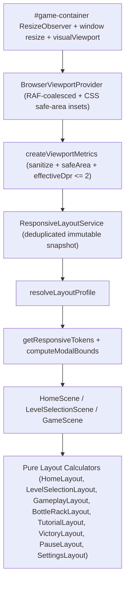
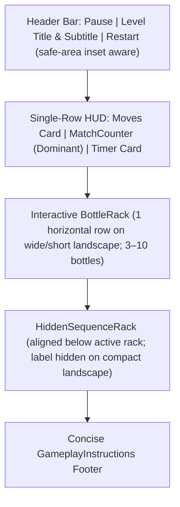
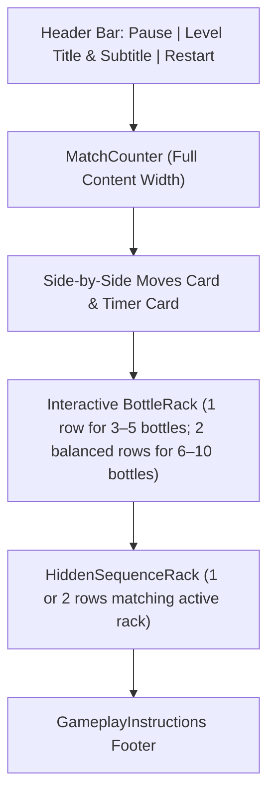
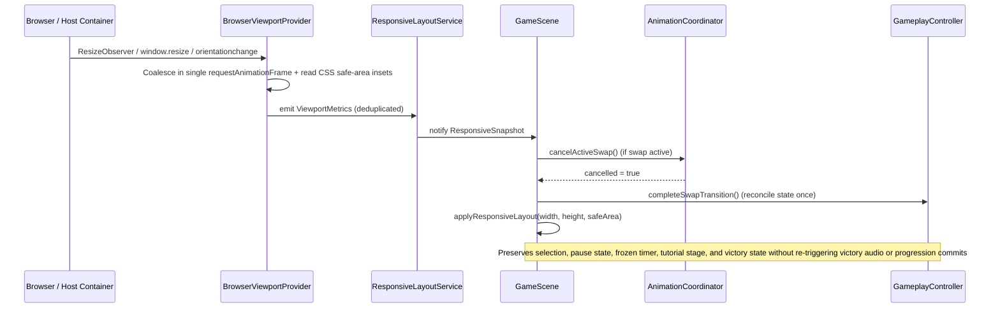

# Responsive Layouts and Cross-Device Optimisation

This document specifies the responsive layout architecture, Phaser scaling policy, layout profiles, bottle-rack geometry algorithm, safe-area handling, orientation/resize reconciliation, and cross-device verification results for **Bottle Shuffle**.

---

## 1. Scaling Strategy and Device Pixel Ratio Policy

Bottle Shuffle uses **`Phaser.Scale.RESIZE`** (`src/config/gameConfig.ts`) with `autoCenter: Phaser.Scale.CENTER_BOTH` and `antialias: true`:

- **1 logical Phaser unit = 1 CSS pixel.** Pointer and touch coordinates map 1:1 with zero coordinate distortion or letterboxing.
- **No forced orientation:** Portrait, landscape, square, and compact embedded host containers (including desktop browsers and mobile WebViews such as future YouTube Playables containers) all adapt directly from measured container dimensions.
- **No browser zoom lock:** `index.html` uses `<meta name="viewport" content="width=device-width, initial-scale=1.0, viewport-fit=cover" />` without `maximum-scale=1.0` or `user-scalable=no`. `touch-action: none` and `user-select: none` are scoped strictly to `#game-container` and `#game-container canvas`.
- **DPR Policy:** `clampEffectiveDpr(rawDpr)` (`src/game/layout/ViewportMetrics.ts`) caps effective DPR at **`2`** (`RESPONSIVE_CONFIG.maxEffectiveDpr = 2`), preserving crisp HiDPI typography while preventing unnecessary GPU framebuffer overhead on 3×/4× displays.

---

## 2. Responsive Layout Architecture

Container dimensions and CSS safe-area insets (`--sat`, `--sar`, `--sab`, `--sal`) are measured via `BrowserViewportProvider` (`src/platform/browser/BrowserViewportProvider.ts`), coordinated through `ResponsiveLayoutService` (`src/services/ResponsiveLayoutService.ts`), and classified into one of five canonical `LayoutProfile` values by `LayoutProfileResolver` (`src/game/layout/LayoutProfileResolver.ts`).

---

## 3. Canonical Layout Profiles and Breakpoints

All thresholds live in `src/config/ResponsiveConfig.ts` and depend strictly on measured container dimensions (never user-agent sniffing):

| Profile              | Classification Rule                                          | Typical Viewports                                     | Primary Adaptation                                                                                                                    |
| :------------------- | :----------------------------------------------------------- | :---------------------------------------------------- | :------------------------------------------------------------------------------------------------------------------------------------ |
| `compact-portrait`   | `height > width` and `width < 400`                           | `320×480`, `320×568`, `360×640`, `390×844`            | Compact vertical header/HUD, 2-row bottle rack for 6–10 bottles, bounded Settings scroll on ultra-short `<500px` heights              |
| `standard-portrait`  | `height > width` and `width >= 400`                          | `430×932`, `768×1024`                                 | Comfortable portrait spacing, 2-row rack for 6–10 bottles, generous CTA & progress cards                                              |
| `compact-landscape`  | `width >= height` and `height < 450`                         | `568×320`, `600×340`, `640×360`, `844×390`, `932×430` | Tight 44–48px header, scaled single-row HUD, single-row bottle rack maximizing legibility, two-column Pause/Victory/Settings overlays |
| `standard-landscape` | `width >= height`, `height >= 450`, below expanded threshold | `1024×768`                                            | Balanced single-row landscape gameplay, single-column centered overlays                                                               |
| `expanded-landscape` | `width >= 1100` and `height >= 650`                          | `1280×720`, `1920×1080`                               | Centered `maxContentWidth = 1220px` stage preventing excessive stretching on wide desktop monitors                                    |

---

## 4. Gameplay Layout Structure

### Landscape Gameplay (`compact-landscape`, `standard-landscape`, `expanded-landscape`)

### Portrait Gameplay (`compact-portrait`, `standard-portrait`)

---

## 5. Bottle Rack Layout Algorithm

Implemented cleanly in `src/game/components/environment/bottleLayout.ts` and re-exported from `src/game/layout/BottleRackLayout.ts`:

1. **Sanitize & clamp inputs:** Bottle count clamped to `3..10`; container width/height sanitized against `NaN`, `0`, or negatives.
2. **Evaluate 1-row vs 2-row candidates:**
   - Each candidate strictly respects **both** `maxWidthByColumns` and `maxWidthByHeight`, preserving the exact `1:2` (`256×512`) source aspect ratio.
   - Portrait uses 1 row for `3–5` bottles and 2 balanced rows (`ceil(n/2)` top, `floor(n/2)` bottom) for `6–10` bottles.
   - Landscape selects 1 row whenever single-row width meets comfortable touch sizing OR yields a larger visual bottle than 2 rows (critical on short landscape viewports like `568×320` and `600×340`).
3. **Separate visual bounds from hit-area bounds:**
   - Visual `bottleWidth` / `bottleHeight` fit strictly inside `availableWidth × availableHeight` with zero vertical/horizontal clipping.
   - Interactive `hitWidth` / `hitHeight` expand toward `minTouchTarget` (`48px`) clamped to `floor(bottleWidth + horizontalSpacing - 2)` horizontally and `floor(bottleHeight + shelfThickness + verticalSpacing - 2)` vertically so adjacent bottle hit areas **never overlap**.
4. **Deterministic logical ordering:** Slots are always indexed `0..N-1` left-to-right, top-to-bottom across every viewport and orientation.

---

## 6. Orientation Change & Resize Reconciliation Sequence

---

## 7. Safe-Area Handling

- `index.html` declares `:root { --sat: env(safe-area-inset-top, 0px); --sar: env(safe-area-inset-right, 0px); --sab: env(safe-area-inset-bottom, 0px); --sal: env(safe-area-inset-left, 0px); }`.
- `BrowserViewportProvider` reads those computed properties and normalizes them via `normalizeSafeArea` (clamping extreme insets so effective usable bounds never collapse below `200×200px`).
- All screen layouts (`HomeLayout`, `LevelSelectionLayout`, `GameplayLayout`, `TutorialLayout`, `VictoryLayout`, `PauseLayout`, `SettingsLayout`) and `Modal` position controls strictly inside `viewport.contentBounds`, while backgrounds and overlay scrims remain full-bleed across the entire viewport.

---

## 8. Development-Only Responsive Diagnostic Scene

In development builds (`import.meta.env.DEV`), open `/?scene=responsive` to launch `ResponsiveShowcaseScene` (`src/game/scenes/ResponsiveShowcaseScene.ts`). It is dynamically imported only inside `if (import.meta.env.DEV)` in `src/main.ts` and verified absent from production bundles.

Features:

- Cycle simulated viewport presets (`Live`, `320×480`, `320×568`, `390×844`, `568×320`, `844×390`, `1024×768`, `1280×720`)
- Adjust bottle count (`3..10`) live
- Toggle simulated notch safe-area insets (shaded in amber)
- Toggle cyan layout-region bounds & green non-overlapping bottle hit-area outlines
- Toggle reduced motion and inspect live viewport/profile/DPR/rack metrics

---

## 9. Viewport Verification Matrix (Observed Results)

All 14 viewports were verified both deterministically via Vitest (`tests/unit/layout/BottleRackLayoutMatrix.test.ts`, `tests/unit/layout/ScreenLayoutsMatrix.test.ts`, `tests/unit/layout/ViewportAndProfile.test.ts`) and live in headless Chrome CDP (`25` screen/viewport checks + live multi-orientation resize transitions with `0` console/page errors and `0` unintended scrollbars):

| Viewport    | Profile              | Automated Layout Matrix (3–10 Bottles & All Screens) | Headless Chrome Runtime Check                  |
| :---------- | :------------------- | :--------------------------------------------------- | :--------------------------------------------- |
| `320×568`   | `compact-portrait`   | Pass                                                 | Pass (0 errors, no scroll, exact canvas match) |
| `360×640`   | `compact-portrait`   | Pass                                                 | Pass (0 errors, no scroll, exact canvas match) |
| `390×844`   | `compact-portrait`   | Pass                                                 | Pass (0 errors, no scroll, exact canvas match) |
| `430×932`   | `standard-portrait`  | Pass                                                 | Pass (0 errors, no scroll, exact canvas match) |
| `568×320`   | `compact-landscape`  | Pass                                                 | Pass (0 errors, no scroll, exact canvas match) |
| `640×360`   | `compact-landscape`  | Pass                                                 | Pass (0 errors, no scroll, exact canvas match) |
| `844×390`   | `compact-landscape`  | Pass                                                 | Pass (0 errors, no scroll, exact canvas match) |
| `932×430`   | `compact-landscape`  | Pass                                                 | Pass (0 errors, no scroll, exact canvas match) |
| `768×1024`  | `standard-portrait`  | Pass                                                 | Pass (0 errors, no scroll, exact canvas match) |
| `1024×768`  | `standard-landscape` | Pass                                                 | Pass (0 errors, no scroll, exact canvas match) |
| `1280×720`  | `expanded-landscape` | Pass                                                 | Pass (0 errors, no scroll, exact canvas match) |
| `1920×1080` | `expanded-landscape` | Pass                                                 | Pass (0 errors, no scroll, exact canvas match) |
| `600×340`   | `compact-landscape`  | Pass                                                 | Pass (0 errors, no scroll, exact canvas match) |
| `320×480`   | `compact-portrait`   | Pass                                                 | Pass (0 errors, no scroll, exact canvas match) |

---

## YouTube Playables Certification Aspect Ratios (Task 17)

- Verified all 9 YouTube Playables certification aspect ratios (`9:32`, `9:21`, `9:16`, `3:4`, `1:1`, `4:3`, `16:9`, `21:9`, `32:9`) plus temporary `0×0` zero-sized embedded containers in `tests/integration/YouTubePlatformIntegration.test.ts` with finite coordinates and zero forced orientation or zoom lock. See [PLATFORM_COMPLIANCE.md](./PLATFORM_COMPLIANCE.md).
