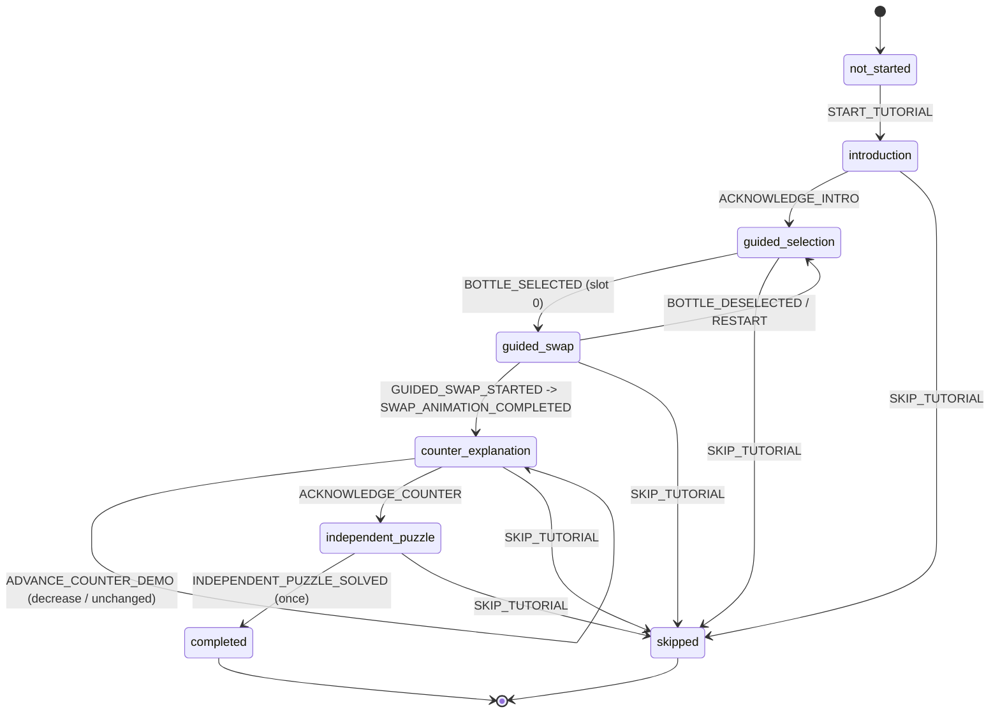

# Interactive Tutorial and First-Time Player Experience — Bottle Shuffle

This document describes the learning sequence, deterministic fixtures, pure tutorial state machine, input policy, UI components, gameplay engine integration, first-time player routing, skip/replay behaviour, responsive layouts, accessibility, and testing strategy for **Bottle Shuffle's** interactive tutorial.

---

## 1. Objectives & Design Principles

- Teach all core deduction rules through actual gameplay interactions within ~30–60 seconds, with no time limit, no countdown pressure, no account creation, and no multi-slide manual:
  1. Hidden target sequence & goal of matching every slot.
  2. Bottle selection highlight, pair swapping, and tap-again deselection.
  3. Move counting (1 valid swap = 1 move; rejected tutorial taps never count).
  4. Aggregate match counter (`X / N`) — reports total correct positions only, never which bottles are right, and can increase, decrease, or remain unchanged.
  5. Independent puzzle solving and puzzle completion.
- Reuse the authoritative `GameEngine`, `GameplayBoard`, `GameplayHUD`, swap animations, `AnimationCoordinator`, and design system via an explicit `mode: 'tutorial'` inside `GameScene` rather than duplicating gameplay scene code.

---

## 2. Learning Sequence & Deterministic Fixtures (`src/core/tutorial/`)

All tutorial fixtures are handcrafted, deeply frozen, and validated at startup via `assertValidPuzzle()` (`TutorialPuzzleFactory.ts`). Counter demonstration deltas are calculated dynamically through `MatchCalculator` and `BottleSwapper` — never hardcoded in presentation.

| Stage | Stage ID              | Puzzle Fixture                                             | Initial Sequence → Target                                                                                                               | Initial Matches   | Concept Taught                                                                       |
| ----- | --------------------- | ---------------------------------------------------------- | --------------------------------------------------------------------------------------------------------------------------------------- | ----------------- | ------------------------------------------------------------------------------------ |
| 1     | `introduction`        | `tutorial-guided-01`                                       | `[blue, red, green]` → `[red, blue, green]`                                                                                             | `1 / 3`           | Hidden sequence compartment & goal                                                   |
| 2     | `guided_selection`    | `tutorial-guided-01`                                       | `[blue, red, green]` → `[red, blue, green]`                                                                                             | `1 / 3`           | Tap highlighted bottle (`slot 0`) to select                                          |
| 3     | `guided_swap`         | `tutorial-guided-01`                                       | `[blue, red, green]` → `[red, blue, green]`                                                                                             | `1 / 3` → `3 / 3` | Tap second bottle (`slot 1`) to swap (or tap `slot 0` to deselect)                   |
| 4     | `counter_explanation` | `tutorial-counter-decrease` & `tutorial-counter-unchanged` | Decrease: `[red, green, blue, yellow]` (`2/4` → `1/4`, swap `0↔1`); Unchanged: `[blue, green, yellow, red]` (`0/4` → `0/4`, swap `0↔2`) | `2 / 4`, `0 / 4`  | Aggregate match counter (increase, decrease, no change) with optional live Demo Swap |
| 5     | `independent_puzzle`  | `tutorial-independent-01`                                  | `[green, red, blue]` → `[red, blue, green]`                                                                                             | `0 / 3`           | Free play until all 3 positions match (2+ swaps)                                     |
| 6     | `completed`           | —                                                          | —                                                                                                                                       | `3 / 3`           | Celebration overlay & launch into preserved campaign destination                     |

---

## 3. Tutorial State Machine (`TutorialEngine.ts`)

- Invalid transitions and duplicate completions are rejected cleanly with typed `TutorialRejectionReason` values.
- Stage advancement after guided swaps waits strictly for `SWAP_ANIMATION_COMPLETED` (reconciled immediately in reduced motion or when a swap is interrupted by resize/pause/suspend).

---

## 4. Input Policy & Gameplay Engine Integration

- **Input Restrictions at Controller Boundary:** `TutorialController` queries `TutorialEngine.evaluateSlotInteraction(slotIndex)` before forwarding taps to `GameEngine.selectBottle(slotIndex)`. Core `BottleSwapper`, `MatchCalculator`, and `GameReducer` contain zero tutorial conditionals.
- Rejected taps during guided stages show gentle inline guidance (`"Tap the highlighted bottle to continue."`) without mutating puzzle state or incrementing move count.
- Independent play restores unrestricted bottle tapping, deselection, and restart support, with an optional non-spoiler inactivity reminder (`12s`: `"Try swapping two bottles and watch the counter."`).
- Tutorial completions never unlock campaign levels or modify `ProgressionController` records.

---

## 5. Tutorial UI Components & Animations

- **`TutorialHeader.ts` & `TutorialProgressIndicator.ts`:** Pause button, `How to Play` title, segmented `Step K of 5` progress indicator (derived from `TOTAL_INSTRUCTIONAL_STEPS`), Restart button (during independent play), and an always-visible `Skip` control.
- **`TutorialInstructionPanel.ts`:** Inline elevated card anchored below the gameplay board via `TutorialLayout` so it never obscures bottles, the hidden compartment, or `MatchCounter`.
- **`TutorialSpotlight.ts` & `SpotlightAnimation.ts`:** Lightweight 4-rectangle surrounding dim scrim + pulsing gold outline frame (zero shader masking, never blocks clicks inside the highlighted hole, static in reduced motion).
- **`TutorialPointer.ts` & `PointerAnimation.ts`:** Crisp golden `TAP` badge + downward pointer positioned above the target bottle cap (never covering center accessibility symbols), with subtle vertical bob paused on reduced motion or suspend.
- **`TutorialCompletionOverlay.ts`:** Celebratory `Modal` (`"You're ready!"`) with context-aware continuation CTA (`PLAY LEVEL 1` / `PLAY LEVEL N` for first-time campaign entry; `BACK TO HOME` / `BACK TO LEVELS` for manual replay).

---

## 6. First-Time Routing, Skip, Replay & Lifecycle

- **`TutorialPreferenceService.ts`:** Session-scoped preference owner (`'not_seen' | 'completed' | 'skipped'`) instantiated once in `src/main.ts`.
- **Centralised First-Time Routing (`SceneNavigator.ts`):** `resolveCampaignLaunchSceneData()` intercepts `launchCampaignLevel(levelId, returnTo)` whenever status is `'not_seen'`, launching `GameScene` in `mode: 'tutorial'` while preserving `nextCampaignLevelId` and `returnTo`. Applies uniformly across `HomeScene` (`PLAY`/`CONTINUE`) and `LevelSelectionScene` (`Play Level`).
- **Skip:** Cancels animations, marks `'skipped'` (only if currently `'not_seen'`; never downgrades `'completed'`), and proceeds immediately to the preserved campaign level (or originating screen on replay).
- **Replay:** Accessible via **Settings → How to Play** on `HomeScene` (`HomeController.launchTutorialReplay()`). Resets fixtures and local counters while preserving campaign progress and existing `'completed'` status.
- **Pause, Restart & Abandon:** Pause suspends timers, spotlight, and pointer animations; Restart reconciles the current puzzle and guided stage; exiting via Pause abandons without marking `'completed'` or `'skipped'` so first-time players are offered onboarding again next attempt.

---

## 7. Responsive Layouts, Accessibility, Testing & Known Limitations

- **`TutorialLayout.ts`:** Reserves dedicated bottom clearance for `TutorialInstructionPanel` inside `calculateGameplayLayout` across `1920×1080`, `1280×720`, `844×390`, `540×960`, `390×844`, and `360×640` without forcing orientation.
- **Accessibility:** Keyboard navigation (`ArrowLeft`/`ArrowRight`, `Enter`/`Space`, `Escape`), visible selection and spotlight outlines, non-colour bottle symbols, reduced-motion support, and no hover-only instructions. Full screen-reader DOM semantics inside Phaser `<canvas>` remain a known platform limitation.
- **Testing:** `tests/unit/tutorial/TutorialPuzzles.test.ts`, `TutorialEngine.test.ts`, `TutorialControllerAndRouting.test.ts`, and `tests/integration/TutorialFlow.test.ts`.
- **Persistence (Task 15):** Tutorial completion status (`not_seen` / `completed` / `skipped`) is persisted immediately via `SaveService` (`high` priority) and restored on startup so completed players are not forced back into first-time onboarding while manual replay remains available without affecting campaign records.

## Task 13 Update — Tutorial Pause & Settings Lifecycle

`TutorialController` now coordinates pause, settings, restart/exit confirmations, and host browser suspension through `GameplayLifecycleCoordinator`, preserving the active tutorial stage, deterministic tutorial puzzle, highlights, and completion history.

---

## Responsive Tutorial Adaptation (Task 16)

- `TutorialLayout` supports 4-sided `SafeAreaInsets` and compact instruction panel heights on ultra-short viewports (`320×480`, `568×320`), ensuring the active bottle board stays unobstructed and spotlight/pointer highlights recalculate cleanly on resize without resetting tutorial stage progress. See [RESPONSIVE_LAYOUT.md](./RESPONSIVE_LAYOUT.md).
