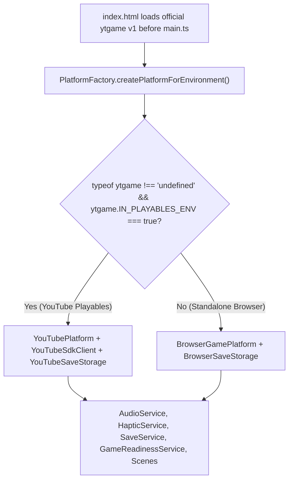
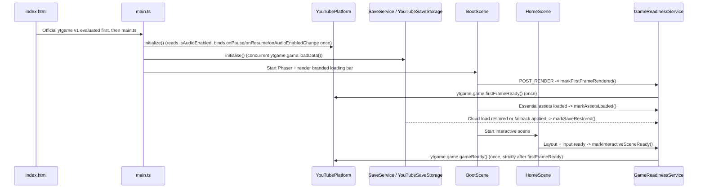
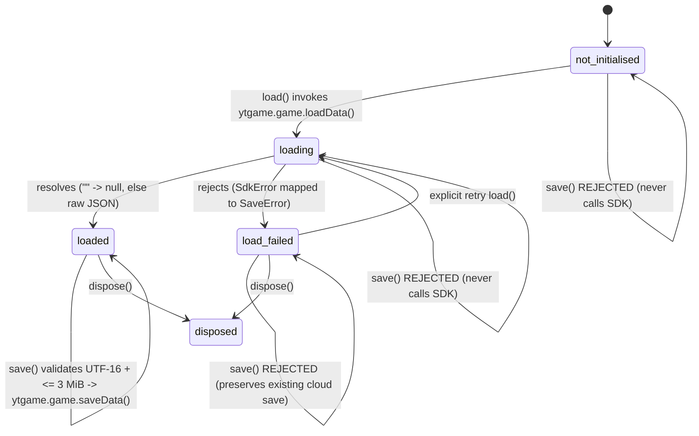
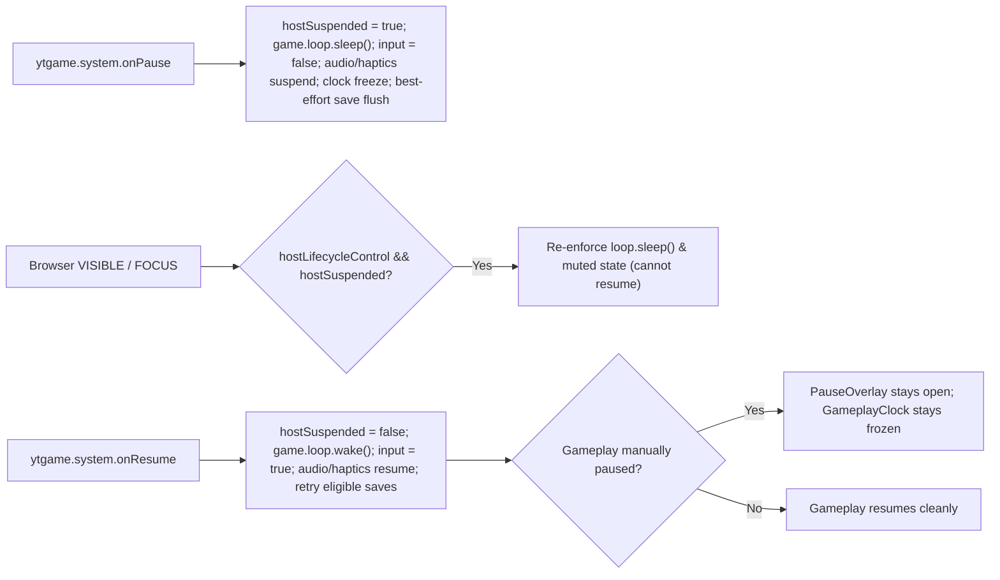

# YouTube Playables SDK Integration

This document records the official YouTube Playables SDK v1 integration for **Bottle Shuffle**, including verified API signatures, platform architecture, readiness sequencing, exclusive cloud persistence, host audio and lifecycle control, build workflow, official Test Suite verification steps, and publishing prerequisites.

- **Documentation Verification Date:** 2026-11-27
- **Official SDK Script URL:** `https://www.youtube.com/game_api/v1`
- **Observed Live SDK Version:** `1.20261116.0100` (resolved from `https://www.youtube.com/game_api/v1` during headless Chrome production preview verification)

---

## 1. Official Documentation References

- Overview: `https://developers.google.com/youtube/gaming/playables`
- Getting Started: `https://developers.google.com/youtube/gaming/playables/reference/getting_started`
- SDK Reference (`ytgame` v1): `https://developers.google.com/youtube/gaming/playables/reference/sdk`
- Integration Requirements: `https://developers.google.com/youtube/gaming/playables/certification/requirements_integration`
- Stability & Performance Requirements: `https://developers.google.com/youtube/gaming/playables/certification/requirements_stability`
- Design Requirements: `https://developers.google.com/youtube/gaming/playables/certification/requirements_design`
- Playables SDK Test Suite: `https://developers.google.com/youtube/gaming/playables/test_suite`

---

## 2. Verified SDK APIs Used

| Official SDK Symbol                      | Verified Signature / Behaviour                                        | Application Mapping                                                                                         |
| :--------------------------------------- | :-------------------------------------------------------------------- | :---------------------------------------------------------------------------------------------------------- |
| `ytgame.IN_PLAYABLES_ENV`                | `boolean` confirming active YouTube Playables host                    | `isYouTubePlayablesEnvironment()` in `YouTubeSdkClient.ts`                                                  |
| `ytgame.SDK_VERSION`                     | `string` SDK version identifier                                       | `YouTubePlatform.getSdkVersion()`                                                                           |
| `ytgame.game.firstFrameReady()`          | `() => void` — signals first meaningful rendered frame                | `GameReadinessService.markFirstFrameRendered()` (BootScene `POST_RENDER`)                                   |
| `ytgame.game.gameReady()`                | `() => void` — signals interactive readiness                          | `GameReadinessService.markInteractiveSceneReady()`                                                          |
| `ytgame.game.loadData()`                 | `() => Promise<string>` — returns serialized string (`""` if empty)   | `YouTubeSaveStorage.load()`                                                                                 |
| `ytgame.game.saveData(data)`             | `(data: string) => Promise<void>` — well-formed UTF-16 `<= 3 MiB`     | `YouTubeSaveStorage.save()` (strictly after successful `load()`)                                            |
| `ytgame.system.isAudioEnabled()`         | `() => boolean` — synchronous initial host audio permission           | `YouTubePlatform.initialize()` -> `AudioService`                                                            |
| `ytgame.system.onAudioEnabledChange(cb)` | `(cb: (enabled: boolean) => void) => () => void`                      | `YouTubePlatform` -> `AudioService.setPlatformAudioEnabled()`                                               |
| `ytgame.system.onPause(cb)`              | `(cb: () => void) => () => void`                                      | `YouTubePlatform` -> loop sleep, input disable, audio/haptics suspend, clock freeze, best-effort save flush |
| `ytgame.system.onResume(cb)`             | `(cb: () => void) => () => void`                                      | `YouTubePlatform` -> loop wake, input restore, permitted audio resume, eligible save retry                  |
| `ytgame.system.getLanguage()`            | `() => Promise<string>` — BCP-47 locale tag                           | `YouTubePlatform.getLanguage()` (maps cleanly with `'en'` fallback)                                         |
| `ytgame.health.logError()`               | `() => void` — best-effort rate-limited error signal                  | `YouTubePlatform.logHealthError()` (10s cooldown, zero PII)                                                 |
| `ytgame.SdkError` / `SdkErrorType`       | `UNKNOWN`, `API_UNAVAILABLE`, `INVALID_PARAMS`, `SIZE_LIMIT_EXCEEDED` | `mapYouTubeStorageError()` in `YouTubeErrorMapper.ts`                                                       |

_(Note: `ytgame.engagement.sendScore` and `ytgame.ads.*` are intentionally unused and disabled in Task 17.)_

---

## 3. Platform Architecture & Environment Detection

Only `src/platform/youtube/` communicates with `globalThis.ytgame`. `src/core/`, design-system components, layout calculators, and Phaser scenes remain strictly decoupled behind `GamePlatform`, `SaveStorage`, and `PlatformCapabilities`.



- **No heuristics:** Detection never inspects user-agent strings, URL substrings, referrers, screen dimensions, or `window.parent !== window`.
- **No silent LocalStorage fallback in YouTube:** Even if an individual SDK API is unavailable inside Playables, `PlatformFactory` keeps `YouTubePlatform` active rather than falling back to `localStorage`.

---

## 4. Startup Bootstrap & Readiness Sequencing



---

## 5. Exclusive Cloud Persistence & Mandatory Load-Before-Save Guard

Inside YouTube Playables, `YouTubeSaveStorage` (`src/platform/youtube/YouTubeSaveStorage.ts`) is the exclusive persistence backend. LocalStorage, SessionStorage, IndexedDB, cookies, and remote databases are never touched.



### Save Payload Limits vs Internal Targets

| Threshold                           | Limit                   | Enforcement                                                                       |
| :---------------------------------- | :---------------------- | :-------------------------------------------------------------------------------- |
| Official SDK hard limit             | `3 MiB` (`3,145,728 B`) | Pre-validated in `YouTubeSaveStorage.save()` (UTF-16 & UTF-8) before invoking SDK |
| Official stability recommendation   | `< 500 KiB`             | Observed full 50-level campaign payload: `7,080 B` (`6.91 KiB`)                   |
| Best-effort exit/pause flush budget | `<= 64 KiB`             | Observed payload is ~9× below this ceiling                                        |
| Internal Bottle Shuffle target      | `< 32 KiB`              | Met with 78% headroom (`6.91 KiB` full campaign; `323 B` empty campaign)          |

---

## 6. Host Audio & Lifecycle Suspension



- In YouTube mode (`useBrowserVisibilityLifecycle: false`), `HomeScene`, `LevelSelectionScene`, and `GameScene` do not attach competing `window` `blur`/`focus` pause handlers.
- Host mute (`isAudioEnabled() === false` or `onAudioEnabledChange(false)`) always overrides in-game Music and Sound Effects settings without mutating player preferences.
- Tactile vibration is explicitly disabled (`haptics: false`, `isVibrationSupported() === false`) on YouTube Playables.

---

## 7. Build Workflow & Official Test Suite Instructions

- **Browser development:** `npm run dev` (automatically runs `BrowserGamePlatform` + `BrowserSaveStorage`).
- **YouTube Playables production build & automated audit:**
  ```bash
  npm run build:youtube
  ```
  Produces `dist/` with relative asset paths, official SDK first in `dist/index.html`, zero dev showcases, zero mocks, zero source maps, and runs `scripts/verify-youtube-build.mjs`.
- **Manual Verification with the Official YouTube Playables SDK Test Suite:**
  1. Build the production bundle: `npm run build:youtube`.
  2. Serve `dist/` locally: `npm run preview` (serves at `http://localhost:4173/`).
  3. Open the official **YouTube Playables SDK Test Suite** (`https://developers.google.com/youtube/gaming/playables/test_suite`) in a desktop browser with access to localhost.
  4. Enter `http://localhost:4173/` and load the game inside the Test Suite frame.
  5. Verify live in the Test Suite panel:
     - `ytgame` script load order check passes.
     - `firstFrameReady()` fires once on initial loading frame, followed by `gameReady()` once on interactive Home screen.
     - Cloud `loadData()` completes before any `saveData()` call; completing Level 1 triggers `saveData()` and reloads cleanly.
     - Host Mute / Unmute silences and restores audio without overriding player settings.
     - Host Pause / Resume freezes loop, audio, and clock, and preserves manual PauseOverlay.
     - Dynamic container resizing across portrait, landscape, square, and narrow aspect ratios keeps controls accessible with no page scroll.
     - Zero CSP or network violations.

---

## 8. Publishing Prerequisites & Developer Access

Publishing to YouTube Playables is a gated partner/developer programme managed by Google:

- **Developer Access:** Submit the official **YouTube Playables Interest Form** from `https://developers.google.com/youtube/gaming/playables` to request onboarding.
- **Developer Portal:** Once approved with an eligible YouTube channel, releases are uploaded, tested, and submitted via the **Playables Developer Portal**.
- **Required Submission Assets & Metadata:** Game title, short/long descriptions, category/tags, age/content ratings (IARC/ESRB/PEGI as required by the portal), promotional key art/thumbnails/icons matching portal specs, privacy policy URL (confirming zero personal data collection), and attribution metadata (`CrowdArcade`).
- **Certification Gate:** Passing mock tests or local audits does **not** constitute official YouTube certification; final certification occurs through Google's review pipeline using the official Test Suite and Playables host environments.

---

## 9. Monetisation & Advertising Integration (Task 18)

- Verified `ytgame.ads` bindings (`requestInterstitialAd(): Promise<void>` and `requestRewardedAd(rewardId: string): Promise<boolean>`) are isolated behind `YouTubeSdkClient` and `YouTubeAdvertisingProvider`.
- Pre-roll ads are managed automatically by YouTube; interstitial ads are requested strictly on eligible Victory -> Next Level campaign transitions (coalescing chapter + level boundaries); rewarded ad infrastructure is prepared (`RewardedAdService`) with zero unfinished reward buttons exposed in production.
- See [MONETIZATION.md](./MONETIZATION.md) and [ADVERTISING_TEST_REPORT.md](./ADVERTISING_TEST_REPORT.md) for placement policy, Developer Portal toggles, advertiser-friendly review, and Test Suite advertising checks.
